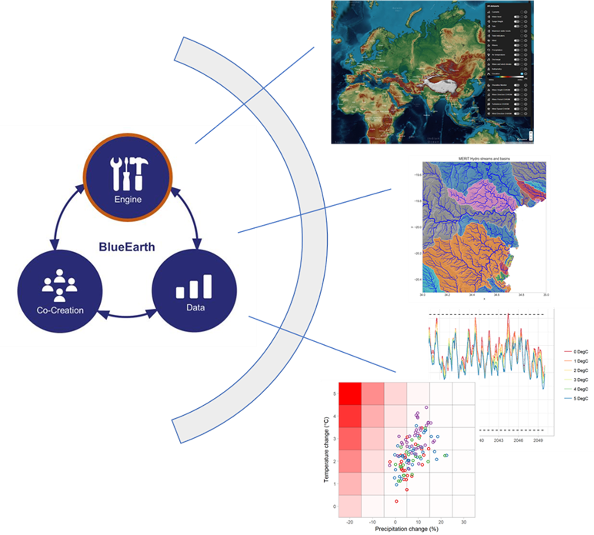

# BlueEarth Climate Stress Test toolbox

[](https://github.com/tanerumit/blueearth_cst/actions/workflows/ci.yml)

> [!NOTE]
> **Fork status.** This is a personal fork of
> [Deltares/blueearth_cst](https://github.com/Deltares/blueearth_cst).
> [Current development guidance](dev/reference/README.md) describes the applicable practices and design.
> [Milestone history](dev/records/milestones/roadmap.md) preserves phase lineage;
> `CHANGELOG.md` tracks releases; [project status](STATUS.md) summarizes current focus and next actions,
> and `dev/TODO.md` tracks active work.

The BlueEarth Climate Stress Test toolbox (`blueearth_cst`) is a free,
open-source toolkit for interactive climate risk assessment based on bottom-up
analysis principles. It enables end-users to:

- Explore the range of hydro-climatic uncertainty in a chosen geographic area,
  including natural variability and climate-change signals.
- Design and execute climate stress tests against user-defined thresholds and
  indicators.
- Assess the plausibility of identified vulnerabilities using climate model
  projections — i.e. estimate how sensitive a chosen indicator is to climate
  change.
- Visualize results for non-specialist audiences.

The toolbox is part of the [BlueEarth](https://blueearth.deltares.org/)
initiative and uses [weathergenr](https://github.com/Deltares-research/weathergenr) as
its weather generator and [Wflow](https://github.com/Deltares/Wflow.jl) for
hydrological modelling.



## Installation

`blueearth_cst` is a Python + R + Julia toolbox. Python and R dependencies are
managed with [pixi](https://pixi.sh/); Julia and Wflow.jl are managed via the
standard `Project.toml` / `Manifest.toml`. A single `pixi run install` task
wires both layers together.

For a step-by-step walkthrough of a fresh install, see `docs/site/setup/install.md`.

### Prerequisites

1.  **pixi** (manages Python 3.12 + R 4.4 via conda-forge; the exact pins live
    in `pixi.toml` — R is held at 4.4 because conda-forge's 4.5 `r-waveslim`
    build is broken on win-64).

    Windows (PowerShell):

    ```powershell
    iwr -useb https://pixi.sh/install.ps1 | iex
    ```

    Or via winget: `winget install prefix-dev.pixi`. Restart your shell after
    install.

2.  **Julia 1.11.7** via [juliaup](https://github.com/JuliaLang/juliaup).
    conda-forge has no win-64 Julia build, and Wflow.jl 1.0.x deadlocks under
    Julia 1.12. The exact patch is pinned: every Julia call the toolbox makes
    carries the `+1.11.7` selector, so any other 1.11.x fails to start. After
    installing juliaup:

    ```console
    juliaup add 1.11.7
    ```

    Verify with `julia +1.11.7 --version` (expect `1.11.7`). No
    `juliaup default` is needed — the selector picks the version.

3.  Clone the repo:

    ```console
    git clone https://github.com/tanerumit/blueearth_cst.git
    cd blueearth_cst
    ```

### Install

```console
pixi install         # Python + R toolchain (conda-forge)
pixi run install     # weathergenr (R) + Wflow.jl (Julia)
```

The first command installs everything declared in `pixi.toml` into a local
`.pixi/` env. The second runs `dev/scripts/install_weathergenr.R` (installs
`Deltares-research/weathergenr@v2.0.1`) and
`julia +1.11.7 --project=. -e 'using Pkg; Pkg.instantiate()'` (locks Wflow.jl
and ~130 transitive Julia deps from `Manifest.toml`).

To activate the env in your shell:

```console
pixi shell
```

### Docker

Not supported. The pixi-based toolbox ships no Docker image; Docker returns with the deferred Linux
replication work (see `dev/records/milestones/roadmap.md`). The v0.1.0-alpha conda-based image remains at
`containers.deltares.nl/CST/cst_workflows:0.1.0`.

## Running

The five workflows separate historical characterization, generation, model
construction, simulation and projection analysis:

| Entry point | Id | Purpose |
|---|---|---|
| `analyze_climate.smk` | wf0 | Optional model-free historical climate analysis |
| `build_model.smk` | wf1 | Build Wflow-SBM and run historical forcing |
| `analyze_projections.smk` | wf2 | CMIP6 plausibility overlay |
| `generate_scenarios.smk` | wf3 | Generate and retain a scenario collection |
| `simulate_system.smk` through `scripts/simulate_system.py` | wf4 | Simulate a ready collection or reduce retained responses |

Generation and model construction are independent prerequisites of simulation.
Projections never drive generation. Run WF0 alone when selecting historical
forcing; otherwise run it first or omit it.

WF0 compares only variables each source actually provides. A CHIRPS source
added only as a comparison candidate therefore reads and stores precipitation
only. When CHIRPS is the selected pipeline source, the shared store is instead
enriched with ERA5 temperature, radiation and pressure plus orography because
WF1 and WF3 require the complete forcing contract.

WF0 retains coverage, extreme indices, SPI, trends and diagnostic tables under
each source store's `tables/`. Multiple sources also produce
`comparison/tables/` and `comparison/plots/`, with agreement tables and common-period figures.
Machine-readable diagnostics live in `_engine/` and plot captions in `plots/_engine/`; readable captions
live in `plots/figure_captions.md`. Agreement does not establish accuracy or forcing
suitability. A single-source run keeps its diagnostics without a comparison.
CHIRPS daily precipitation labelled `mm` is now labelled `mm d**-1` without
rescaling values. Retained CHIRPS stores need regeneration to receive the label.

WF0's canonical plots are PNGs in each store's `plots/`. They replace WF0's
former monthly boxes, plain annual series and comparison lines. Subbasin plots
and captioned copies are off by default. WF0 exclusively owns source diagnostics;
WF1 produces model-forcing and evaluation figures only. Existing `figures/` and
`diagnostics/` outputs are no longer targeted and are not automatically deleted.
See the [WF0 guide](docs/site/toolbox-reference/workflow-analyze-climate.qmd)
for settings, outputs and scientific limitations.

### Configuration

Start from `test_case/project_config_rapid.yml` for execution checks. A project
file has five closed `{enabled, config_path}` stanzas. Each settings file sits
beside it; `config_path` resolves from the project file, while ordinary paths
resolve from the working directory. Shared basin, climate and model keys stay
in the project file. Production `project_dir` belongs outside the checkout.

`project.catalog` accepts one catalog path or an ordered list. HydroMT loads
lists in order, so a later project-owned catalog can replace a named source
without modifying an upstream catalog. The rapid config uses this mechanism to
load `config/catalogs/deltares_era5_daily_zarr.yml` after the
`deltares_data_pdrive.yml` base. Both catalogs read the Deltares P-drive. Its `era5` entry uses
`raster_xarray` with Zarr-compatible options only and covers 1950-01-02 through
**2023-02-01**. ERA5 extraction refuses requested dates outside advertised
catalog coverage rather than silently returning the overlap. The baseline
config also uses the P-drive catalog; its explicit river and land-cover source
names follow that catalog. This changes the model inputs relative to the prior
local-data baseline and requires a new numerical baseline record.

Generation owns realization count, simulation window, perturbations, generator
settings, seed and unit capacity. Simulation owns `experiment_name`, the required
`operation`, optional `scenario_collection: {manifest_path: ...}`, compute controls
and indicator selection. New `auto` seeds are independent of experiment names and
identifier capacity. An older (pre-R14) project config is migrated with
`scripts/migrate_project_config.py` from release `v0.3.0`, the last that ships it.

### Commands

Activate `pixi shell`, or prefix commands with `pixi run`:

```console
python scripts/run_workflow.py analyze_climate --config test_case/project_config_rapid.yml --project-dir test_case/test_rapid --cores 3
python scripts/run_workflow.py build_model --config test_case/project_config_rapid.yml --project-dir test_case/test_rapid --cores 3
python scripts/run_workflow.py analyze_projections --config test_case/project_config_rapid.yml --project-dir test_case/test_rapid --cores 3 --keep-going
# Enable only generate_scenarios in this config to run WF3 alone.
python scripts/run_workflows.py --config <wf3-only-project-config.yml> --project-dir <project-dir> --cores 3
python scripts/simulate_system.py --config test_case/project_config_rapid.yml --target all --cores 3
```

Or run all enabled workflows in that fixed convenience order:

```console
pixi run python scripts/run_workflows.py --config test_case/project_config_rapid.yml --project-dir test_case/test_rapid --cores 3
```

Preflights run immediately before their consumer, after preceding producers.
When simulation is enabled, the runner announces experiment preparation and shows
elapsed-time notices during long waits. Its change checks compare source YAML,
catalog root locations and input/code identities without loading HydroMT. The
consuming workflows perform HydroMT catalog and adapter validation. See
[startup checks and compatibility](docs/site/toolbox-reference/retained-handoffs.qmd#startup-input-checks).
Generation uses the owned all-workflow runner, which may be configured with only
WF3 enabled. Simulation must use its dedicated runner or
the all-workflow runner; bare `simulate_system.smk` invocation is unsupported.
`--dry-run` shows a partial DAG until a missing source or indicator checkpoint has
resolved its content identity. Each workflow executes once per invocation.

Snakemake flags go after a `--` sentinel and are appended verbatim to every
invoked workflow — this is how you pass `--rerun-incomplete`, `--dry-run`,
`--notemp`, `--unlock` or `-p`, since the wrapper's own flags are only
`--config`, `--cores` and `--simulation-target`:

```console
$ pixi run python scripts/run_workflows.py \
    --config test_case/project_config_baseline.yml \
    --project-dir test_case/test_local \
    -- --rerun-incomplete
```

### Retained results and indicators-only

Immutable collection data live under `scenarios/_engine/data/<collection_id>/`, selected by the
exact `scenarios/_engine/requests/<generation_request_id>/request.json` or an explicit manifest.
Simulation never creates missing collections. A missing or stale plan names the
generation command required to resolve it; no directory scan or latest fallback
is used. The current collection is exported directly to `scenarios/` for inspection.
Existing collections at `scenarios/<collection_id>/` remain readable and reusable in place;
new runs no longer create that visible hashed directory.

Across all five workflows, configuration archives put captured project/workflow files and
`SOURCES.md` beside `run_record.yml`, with catalogs in `catalogs/`. New archives use
`source-archive/2`; existing `source-archive/1` archives retain their `sources/` layout and remain
readable without migration. Reserved or colliding names receive deterministic suffixes, with original
paths recorded in the manifest and source index. Execution and recovery roots stay under `_engine/`.

Each `experiments/<experiment_name>/` retains `_engine/simulation.json`, its native
`hydrology/wflow/output/<run_id>.csv` responses and
`_engine/response_inventory.json`. Indicator sets live in
`_engine/indicator_sets/<indicator_set_id>/data/`, with the selected tables exported directly to
`results/indicator_sets/`. Existing sets under `results/indicator_sets/<indicator_set_id>/` remain readable
and reusable in place. Each variable has separate
`<token>_run_indicators.csv` (`indicator,location,run_id,value`) and
`<token>_group_indicators.csv` (`indicator,location,group_id,value`) tables.
Text IDs such as `run_01` and `group_01` use independent namespaces.
`group_members.csv` records every group member, including singleton groups;
`group_metadata.csv` joins groups to `perturbation_lookup.csv` through `st_id`.
Run tables join directly to the collection's `scenario_run_lookup.csv`.
Group summaries give equal weight to each realization's run indicator; return levels retain
pooled-sample estimation. See [Reading the outputs](docs/guide/outputs.md) for validity and migration.
Collection inventories live in `scenarios/_engine/collections/<collection_id>/`;
indicator metadata lives in the experiment's `_engine/indicator_sets/<indicator_set_id>/`.
Model-grid forcing and per-run catalogs are temporary. Collection forcing and
native responses are durable.

To reduce existing responses, set `operation: indicators-only` and the existing
`experiment_name` in the simulation settings file, then run:

```console
pixi run python scripts/simulate_system.py --config <project-config> --target simulations_and_indicators
```

The all-workflow runner accepts `--simulation-target simulations_and_indicators` for this operation;
disable other workflows when only retained reduction is wanted. Default target
`all` never infers an operation from files. Indicators-only requires no live model,
generation inputs or Julia. Changed simulation inputs require a new experiment;
changed indicators select a new immutable indicator set. See
[retained handoffs](docs/site/toolbox-reference/retained-handoffs.qmd).

Without an explicit name, experiments start at `stress_test_01`. Plain reruns retain
the highest allocation; completion never advances it. Pass `--new-experiment` to
either runner for the next number, optionally with `--note` for creation metadata.
A custom `experiment_name` base selects another family; an exact numbered name pins
that identity. Changed scientific inputs without the flag refuse before producers.
The suggestion helper is now read-only and does not edit YAML or reserve a folder.
Existing owned dated or unnumbered experiment names remain explicit legacy selections.
See [experiment selection and recovery](docs/guide/running.md#select-resume-or-create-an-experiment).

### Logs and DAGs

Each launcher attempt keeps its summary, console transcript, workflow logs and
benchmark reports together under `logs/<UTC timestamp>__<workflow scope>/`
(for example, `2026-10-20_11-21-55Z__all-workflows`; dry runs append `__dry-run`).
Retries receive a new folder; an all-workflow run shares one folder with its children.
Structured invocation records remain under `config/_engine/invocations/`.
See [execution logs and benchmarks](docs/guide/running.md#execution-logs-and-benchmarks)
for the layout and [benchmark interpretation](docs/guide/benchmarking.md).

```console
# WF3's owned dry run shows the source-preparation DAG.
pixi run python scripts/generate_scenarios.py --config test_case/project_config_rapid.yml --project-dir test_case/test_rapid --cores 3 -- --dry-run
pixi run python scripts/plot_workflow_dag.py -s simulate_system.smk --configfile test_case/project_config_rapid.yml
```

The graph helper applies the shared simulation target validator. Graphs live
under the project's `logs/dag/`; simulation graphs include the experiment name.

## Live applications and feedback

Real basin configurations, concise run records, and ignored execution outputs
live in the separate `cst-cases` repository. Its `README.md` defines the run
record: case config commit, toolbox commit, workflows, outcome, and evidence
path. When a case reveals a toolbox defect or reusable practice, link the
relevant toolbox development task to `cst-cases:applications/<basin>/notes.md`
and identify the dated run. Record the resulting task or fix in that case note.
Keep code changes in this repository and case configurations in `cst-cases`.
## Testing

The test suite has three explicit tiers. For normal development, run the fast
tier; it keeps all pure/unit coverage and excludes only tests that invoke real
Snakemake workflows or require fresh Python processes:

```console
$ pixi run test-fast
```

Run the workflow/process contracts after changing a Snakefile, a workflow
boundary, or process-isolated behaviour:

```console
$ pixi run test-contract
```

The authoritative full non-integration suite remains the unfiltered run. The
Pixi task is only a memorable alias; bare `pytest tests/` has the same meaning:

```console
$ pixi run test-full
$ pixi run pytest tests/
```

`workflow_contract` marks real Snakemake CLI/API/DAG and lifecycle checks;
`process_isolation` marks non-Snakemake proofs that need fresh interpreters. The
markers partition execution cost, not coverage: the full tier runs both. In the
August 2026 clean-Windows measurement, the fast tier ran in about one minute and
the contract tier in about five minutes (roughly 1,070 tests total).

Notes on what the suite does and does not cover:

- Tests that need the untracked `test_case/test_local` fixture tree **skip**
  when it is absent, as do three end-to-end workflow tests that are opt-in
  behind `--run-integration`. Run `pytest -rs` to see every skip reason. The
  August 2026 clean-checkout profile had 31 skips: 28 fixture-dependent checks
  and the three opt-in integrations.
- `dev/scripts/check_baseline.py check` and `dev/scripts/semantic_tree_diff.py`
  compare a produced output tree against a recorded baseline. They are
  **local-only gates** — they need that fixture tree, so CI cannot run them. **A
  green CI badge does not mean the baseline was checked.**
- CI (`.github/workflows/ci.yml`) runs the unit suite on `ubuntu-latest` and
  `windows-latest` for every push to `main` and every pull request.

## Documentation

User-facing:

- **Notebooks** — Jupyter notebooks explaining each workflow live under
  `docs/notebooks/` (inherited from the [upstream
  repository](https://github.com/Deltares/blueearth_cst/tree/main/docs/notebooks)).
- **HydroMT references** — `docs/` also contains HydroMT architecture and
  user-guide content.

Fork-specific (development):

- `dev/records/milestones/roadmap.md` — milestone roadmap: what each phase set out to do and how it
  landed.
- `dev/reference/README.md` — topic map for current development practices and toolbox architecture.
- `dev/reference/dev-git-conventions.md` — branching, tagging, and commit-message conventions.
- `docs/site/setup/install.md` — step-by-step install walkthrough.
- `dev/records/milestones/phase-1/` — sealed foundation milestone artifacts (audits,
  plans, baseline diffs).
- `dev/records/milestones/r01/` … `dev/records/milestones/r06/` — sealed Phase 2 milestone
  designs and review records (modularity contracts, naming, the three workflows,
  structural refactor).
- `dev/records/milestones/p31/`, `dev/records/milestones/p32a/`, `dev/records/milestones/p32b/`,
  `dev/records/milestones/p33/` — sealed Phase 3 milestone designs, review records and
  evidence notes.
- `dev/tasks/` — active work and proposed changes; closure outcomes are linked from `dev/LOG.md`.
- `CHANGELOG.md` — release history (release-level; milestone detail lives in
  `dev/records/milestones/roadmap.md`).

## License

Copyright (c) 2021, Deltares.

This program is free software: you can redistribute it and/or modify it under
the terms of the GNU General Public License as published by the Free Software
Foundation, either version 3 of the License, or (at your option) any later
version.

This program is distributed in the hope that it will be useful, but WITHOUT ANY
WARRANTY; without even the implied warranty of MERCHANTABILITY or FITNESS FOR A
PARTICULAR PURPOSE. See the GNU General Public License for more details.

You should have received a copy of the GNU General Public License along with
this program. If not, see <https://www.gnu.org/licenses/>.
