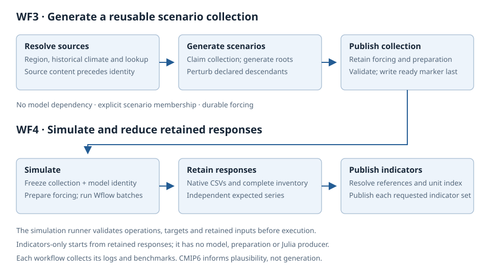

# Toolbox architecture

Last updated: 2026-10-20

Use this reference when changing workflow responsibilities, configuration ownership or retained handoffs.
The [implementation map](toolbox-workflow-map.md) points to executable rules; execution instructions belong in
[the workflow guide](../../docs/site/toolbox-reference/workflows.qmd).

## Workflow boundaries

| Stage | Responsibility | Implementation |
|---|---|---|
| WF0 | Optional model-free historical climate analysis | `analyze_climate.smk` |
| WF1 | Build Wflow and run historical forcing | `build_model.smk` |
| WF2 | Derive projection change factors for plausibility overlays | `analyze_projections.smk` |
| WF3 | Publish durable stochastic scenario collections | `generate_scenarios.smk` |
| WF4 | Simulate systems and publish indicators from retained responses | `scripts/simulate_system.py` |

WF1 and WF3 are independent prerequisites of WF4. WF2 does not select or drive the stress-test experiment.
WF0 shares model-free region/climate producers with other workflows; run it first or omit it when
executing the convenience sequence. The all-workflow runner owns ordering and workflow selection.

WF3 generation identity is independent of experiment names. WF4 selects explicit run identities and
validates retained artifacts before reuse. Metrics-only work consumes complete retained responses and
must not cause model or simulation production. Use the owned runners for WF3/WF4; the runner's validated
operation/target contract is part of the boundary, not an optional shell convenience.

See [retained handoffs](../../docs/site/toolbox-reference/retained-handoffs.qmd) for the supported artifact
interface. The [weather-generator interface](toolbox-weather-generator-interface.md) and
[hydrological-model interface](toolbox-hydrological-model-interface.md) describe replacement-engine obligations
and current adapter requirements.

This is a conceptual view, not a numbered DAG. Edit the [HTML source](../assets/diagrams/scenario-response-handoffs.html)
and regenerate its SVG with `dev/scripts/export_svg.py`; do not edit both copies independently.

## Configuration and execution records

Project settings own shared `basin`, `climate` and `model` sections. Each workflow has a closed
`{enabled, config_path}` stanza pointing to its settings file. Only `config_path` resolves against the
project file; ordinary run paths resolve from the run directory. The parser and schemas in
`blueearth_cst/shared/config_composition.py` own exact fields and composition behavior.

`config/advanced_settings.yml` is always loaded through its closed schema. `config/defaults/` affects
runs; `config/templates/` supplies scaffolds. Keep shared values at their shared owner instead of copying
them into workflow files. [Repository layout](dev-repository-layout.md) owns repository placement details.

Supported WF0–WF2 launches capture original configuration bytes before Snakemake parses execution
documents. `blueearth_cst/shared/workflow_archive_launch.py` owns admission and staging;
`workflow_config_snapshot.py` owns archive publication and validation. Supported launcher attempts use
`invocation_history.py`; source archives and invocation outcomes have different purposes and lifetimes.
The all-workflow and direct simulation runners own their respective launch coverage.

Do not infer broader execution guarantees from historical designs. In particular, an accepted
scheduler-neutral run-contract proposal does not establish universal namespace fencing, resumability or
complete coverage of arbitrary raw Snakemake launches. Consult the actual launcher and its tests before
claiming any of those properties.

## Implementation ownership

The toolbox is a repository-based Python/R/Julia workflow, with no API or frontend in this repository.
`pyproject.toml` is tool configuration, not a packaging manifest; `pixi.toml` owns the environment.
`blueearth_cst/` contains importable and rule-invoked modules, while `scripts/` provides user entry points.
Do not add packaging tables or a build backend as a side effect of tooling changes.

Model-neutral spatial products belong to the [spatial foundation](toolbox-spatial-foundation.md).
Model construction and mutable model-root ordering belong to the [WF1 contract](wf1-model-construction.md).
Historical climate figures belong to WF0/shared climate plotting, not a second subcatchment-climate
plotting path inside model-result evaluation.

## Verification entry points

Use the [validation ladder](dev-validation.md) to select required coverage. The relevant contract
owners include `tests/test_run_workflows.py`, `tests/test_workflow_archive_launch.py`,
`tests/test_invocation_history.py`, and the retained-artifact reader/runner tests.
Test files define executable coverage; this list is navigation, not a separate mandatory gate.
