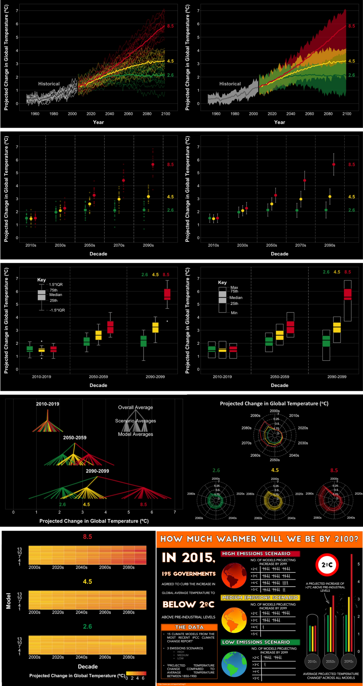
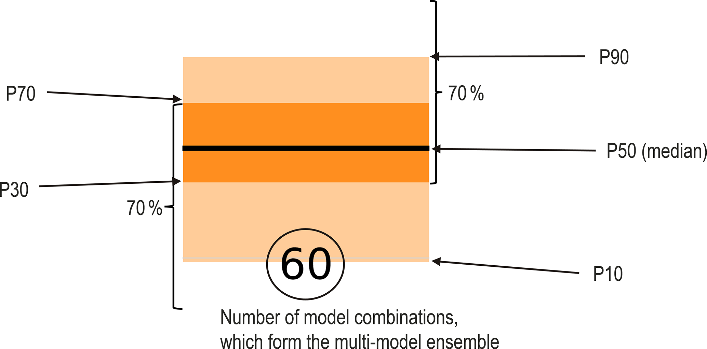

# 2. Communication and explanatory graphics

[Collection index](../README.md) · [Research guide](../../wf2-projections-research-guide.md)

## Compare tested display formats

Ten alternative displays of the same projections; useful for comparing dots, intervals, fans and heatmaps.

**Regional adaptation:** Start with points and intervals for small ensembles. Test readers' ability to
identify magnitude and spread.

**Source:** Bannister et al. (2021), Improving the visual communication of environmental model projections,
Scientific Reports 11, 19157. Figure 1.

[Paper and original caption](https://www.nature.com/articles/s41598-021-98290-4) · [Publisher image](https://media.springernature.com/lw1200/springer-static/image/art%3A10.1038%2Fs41598-021-98290-4/MediaObjects/41598_2021_98290_Fig1_HTML.png)

**Rights:** CC BY 4.0

**File:** 1200 × 2266 pixels; retrieved 2026-10-07; unchanged publisher image.

## Explain the interval before presenting results

A teaching graphic for the meaning of percentile boxes in a participatory adaptation process.

**Regional adaptation:** Label percentiles as summaries of the selected ensemble. They are not automatically
probabilities of future outcomes.

**Source:** Müller and Döll (2024), Quantifying and communicating uncertain climate change hazards in
participatory climate change adaptation processes, Geoscience Communication 7, 121–144. Figure 4.

[Paper and original caption](https://gc.copernicus.org/articles/7/121/2024/) · [Publisher image](https://gc.copernicus.org/articles/7/121/2024/gc-7-121-2024-f04.png)

**Rights:** CC BY 4.0; retain third-party credits shown in the article, including the source diagram and logos
in Figure 3.

**File:** 2068 × 1022 pixels; retrieved 2026-10-07; unchanged publisher image.
