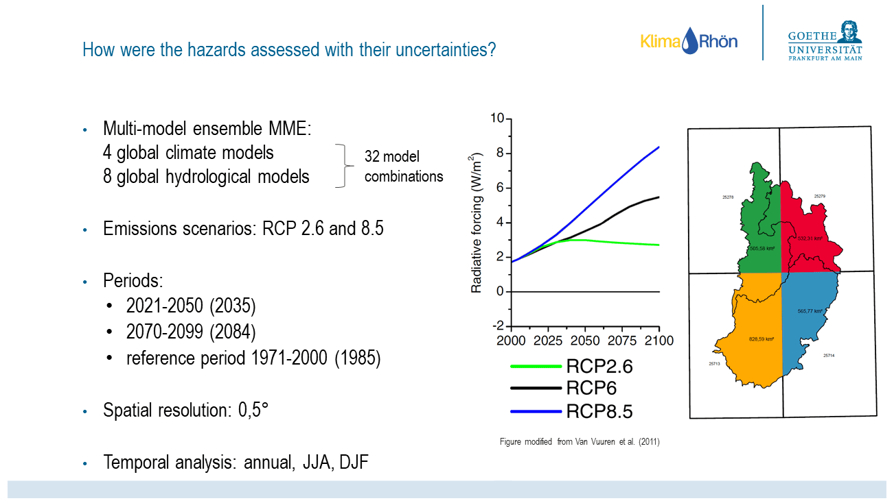
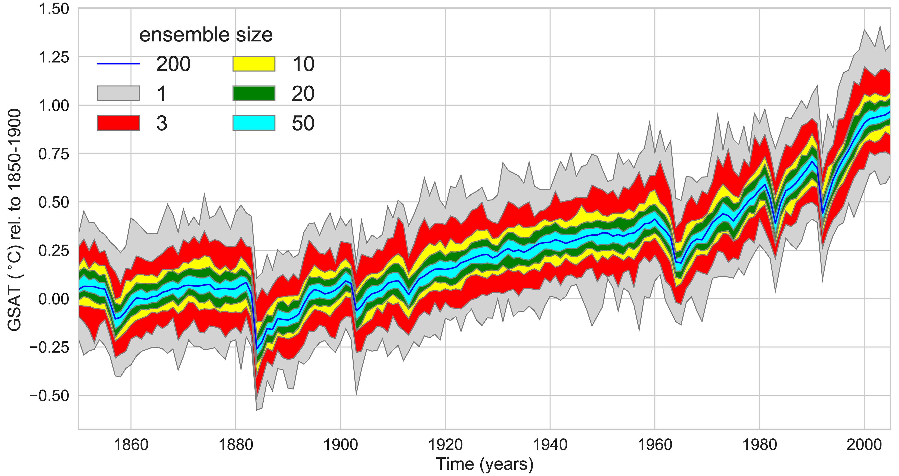

# 3. Shared operational foundation

[Collection index](../README.md) · [Research guide](../../wf2-projections-research-guide.md)

## Show how the evidence was produced

A workshop slide connecting emissions scenarios, model chains, periods and hydrological indicators.

**Regional adaptation:** Replace the model chain with the local analysis provenance, exact windows and spatial
support; keep it separate from findings.

**Source:** Müller and Döll (2024), Quantifying and communicating uncertain climate change hazards in
participatory climate change adaptation processes, Geoscience Communication 7, 121–144. Figure 3.

[Paper and original caption](https://gc.copernicus.org/articles/7/121/2024/) · [Publisher image](https://gc.copernicus.org/articles/7/121/2024/gc-7-121-2024-f03-web.png)

**Rights:** CC BY 4.0; retain third-party credits shown in the article, including the source diagram and logos
in Figure 3.

**File:** 1302 × 734 pixels; retrieved 2026-10-07; unchanged publisher image.

## Distinguish forced response from individual realizations

Ensemble-size-dependent uncertainty around a large-ensemble forced-response estimate.

**Regional adaptation:** Explain whether a panel describes individual future realizations or estimated model
forced responses. These are different quantities.

**Source:** Milinski, Maher and Olonscheck (2020), How large does a large ensemble need to be?, Earth System
Dynamics 11, 885–901. Figure 1.

[Paper and original caption](https://esd.copernicus.org/articles/11/885/2020/) · [Publisher image](https://esd.copernicus.org/articles/11/885/2020/esd-11-885-2020-f01-high-res.png)

**Rights:** CC BY 4.0

**File:** 4205 × 2228 pixels; retrieved 2026-10-07; unchanged publisher image.
