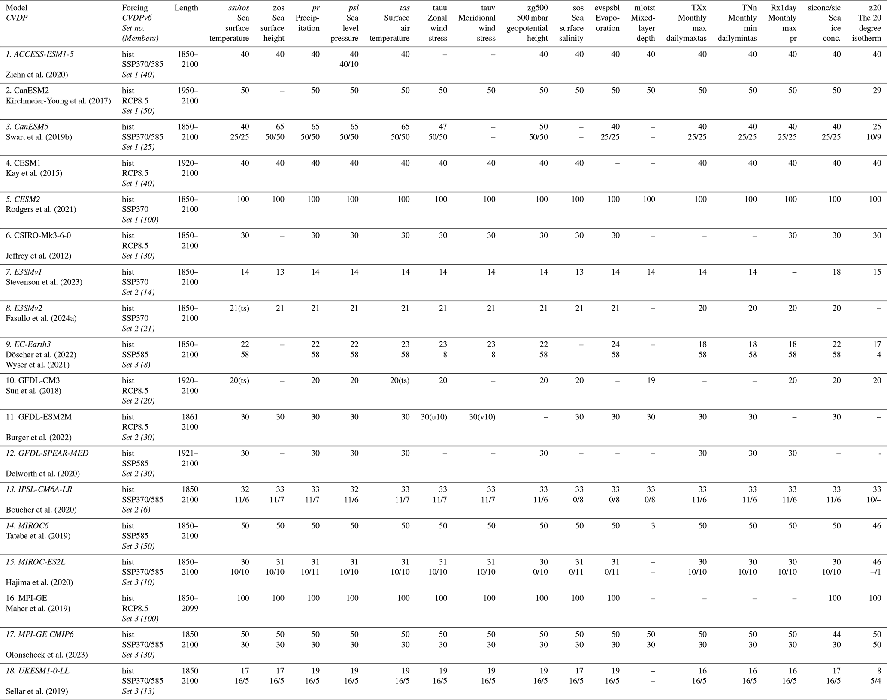

# 4. C0 — Evidence coverage

[Collection index](../README.md) · [Research guide](../../wf2-projections-research-guide.md)

## Make archive coverage visible

Published archive inventory showing models, scenarios, variables and ensemble availability.

**Regional adaptation:** Translate this table into a model-by-scenario availability matrix with resolved
counts, exclusions, missing variables and exact periods.

**Source:** Maher et al. (2025), The updated Multi-Model Large Ensemble Archive and the Climate Variability
Diagnostics Package: new tools for the study of climate variability and change, Geoscientific Model
Development 18, 6341–6365. Table 1.

[Paper and original caption](https://gmd.copernicus.org/articles/18/6341/2025/) · [Publisher image](https://gmd.copernicus.org/articles/18/6341/2025/gmd-18-6341-2025-t01.png)

**Rights:** CC BY 4.0

**File:** 2067 × 1632 pixels; retrieved 2026-10-07; unchanged publisher image.
