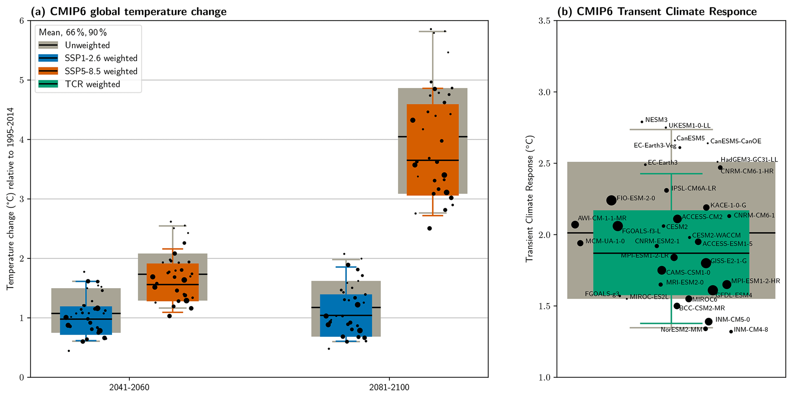

# 4. C1 — Changes in mean conditions

[Collection index](../README.md) · [Research guide](../../wf2-projections-research-guide.md)

## Show the models behind a mean-change summary

Individual model dots, weights and weighted/unweighted summaries across horizons and scenarios.

**Regional adaptation:** For a catchment, use temperature differences and precipitation absolute/relative
changes, paired within each model before aggregation.

**Source:** Brunner et al. (2020), Reduced global warming from CMIP6 projections when weighting models by
performance and independence, Earth System Dynamics 11, 995–1012. Figure 8.

[Paper and original caption](https://esd.copernicus.org/articles/11/995/2020/) · [Publisher image](https://esd.copernicus.org/articles/11/995/2020/esd-11-995-2020-f08-web.png)

**Rights:** CC BY 4.0

**File:** 2067 × 1037 pixels; retrieved 2026-10-07; unchanged publisher image.
