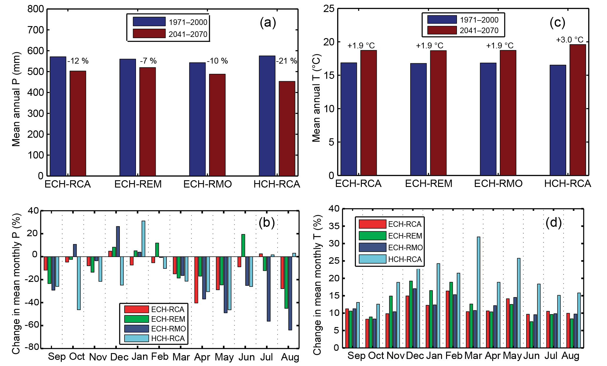
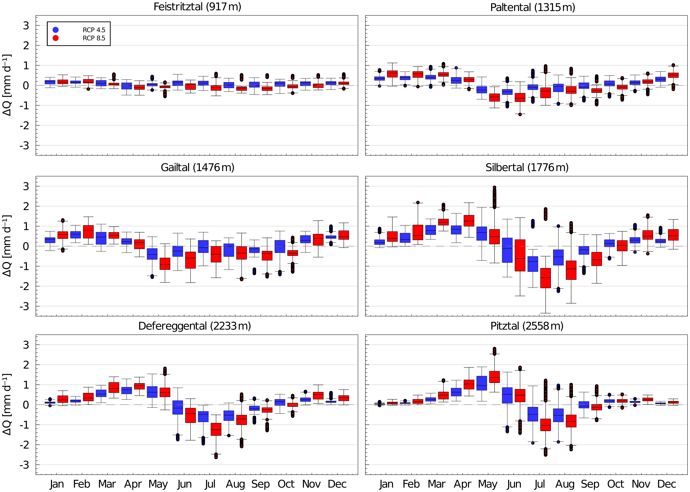

# 4. C2 — Seasonal conditions and redistribution

[Collection index](../README.md) · [Research guide](../../wf2-projections-research-guide.md)

## Catchment climate changes by month

Annual and monthly climate comparisons for a Mediterranean catchment, with individual climate models visible.

**Regional adaptation:** Borrow the monthly layout, but replace relative temperature changes with differences
in degrees. Include absolute rainfall changes in dry months.

**Source:** Perra, Piras, Deidda, Paniconi, Mascaro, Vivoni, Cau, Marras, Ludwig and Meyer (2018), Multimodel
assessment of climate change-induced hydrologic impacts for a Mediterranean catchment, Hydrology and Earth
System Sciences 22, 4125–4143. Figure 4.

[Paper and original caption](https://hess.copernicus.org/articles/22/4125/2018/) · [Publisher image](https://hess.copernicus.org/articles/22/4125/2018/hess-22-4125-2018-f04-web.png)

**Rights:** CC BY 4.0

**File:** 2067 × 1249 pixels; retrieved 2026-10-07; unchanged publisher image.

## Compare the seasonal redistribution across catchments

Monthly change distributions separated by catchment and emissions scenario.

**Regional adaptation:** This figure shows runoff. Reuse its layout for monthly climate changes without
interpreting runoff as a direct precipitation response.

**Source:** Hanus, Hrachowitz, Zekollari, Schoups, Vizcaino and Kaitna (2021), Future changes in annual,
seasonal and monthly runoff signatures in contrasting Alpine catchments in Austria, Hydrology and Earth System
Sciences 25, 3429–3453. Figure 9.

[Paper and original caption](https://hess.copernicus.org/articles/25/3429/2021/) · [Publisher image](https://hess.copernicus.org/articles/25/3429/2021/hess-25-3429-2021-f09-high-res.png)

**Rights:** CC BY 4.0

**File:** 5744 × 4100 pixels; retrieved 2026-10-07; unchanged publisher image.
