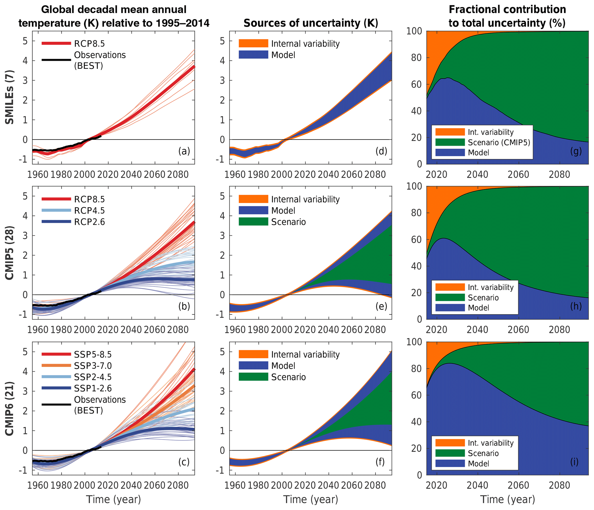

# 4. C3 — Trajectories and calendar horizons

[Collection index](../README.md) · [Research guide](../../wf2-projections-research-guide.md)

## Separate trajectories from the sources of their spread

Smoothed temperature trajectories alongside absolute and fractional projection uncertainty.

**Regional adaptation:** For regional use, label smoothing and membership. A band of smoothed responses does
not show annual weather variability.

**Source:** Lehner et al. (2020), Partitioning climate projection uncertainty with multiple large ensembles
and CMIP5/6, Earth System Dynamics 11, 491–508. Figure 1.

[Paper and original caption](https://esd.copernicus.org/articles/11/491/2020/) · [Publisher image](https://esd.copernicus.org/articles/11/491/2020/esd-11-491-2020-f01-web.png)

**Rights:** CC BY 4.0

**File:** 2067 × 1776 pixels; retrieved 2026-10-07; unchanged publisher image.
