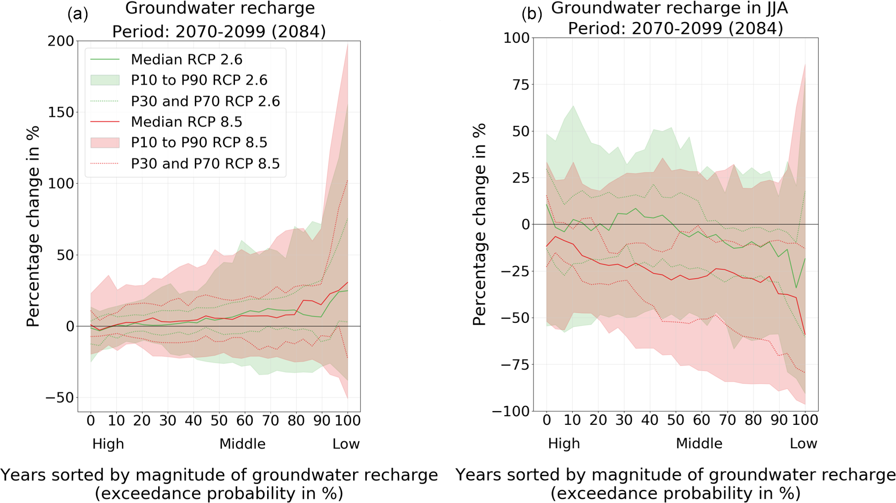
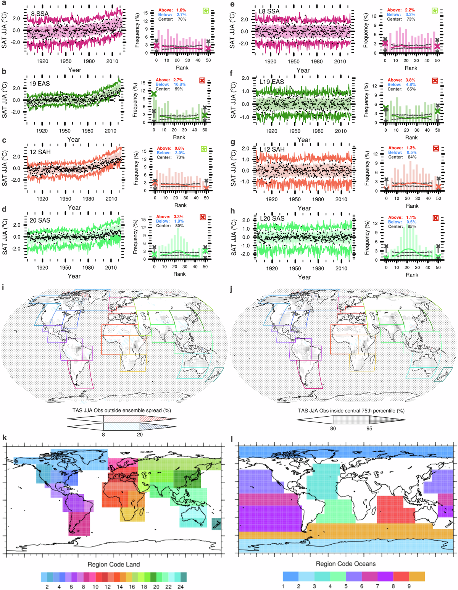
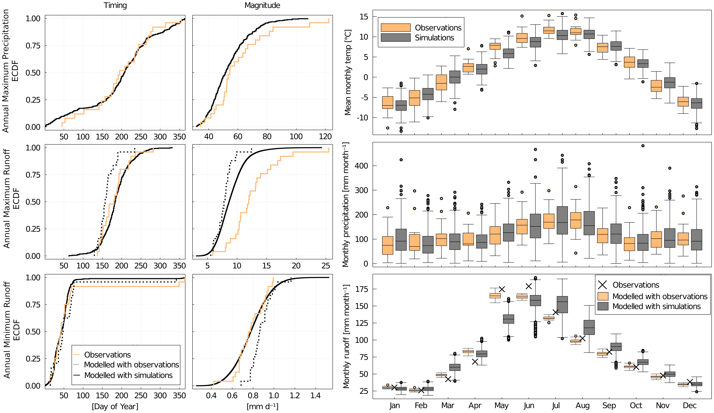

# 4. C4 — Interannual variability and distributions

[Collection index](../README.md) · [Research guide](../../wf2-projections-research-guide.md)

## Show changes across the year-to-year distribution

Hydrological distribution changes summarized at several interannual quantiles.

**Regional adaptation:** For climate variables, retain separate member-level distributions and describe
whether forced trends have been removed.

**Source:** Müller and Döll (2024), Quantifying and communicating uncertain climate change hazards in
participatory climate change adaptation processes, Geoscience Communication 7, 121–144. Figure 6.

[Paper and original caption](https://gc.copernicus.org/articles/7/121/2024/) · [Publisher image](https://gc.copernicus.org/articles/7/121/2024/gc-7-121-2024-f06.png)

**Rights:** CC BY 4.0; retain third-party credits shown in the article, including the source diagram and logos
in Figure 3.

**File:** 1949 × 1094 pixels; retrieved 2026-10-07; unchanged publisher image.

## Check variability before constraining projections

Temperature time series and rank histograms with and without detrending.

**Regional adaptation:** Use alongside regional variability changes to show whether models reproduce the
relevant observed variability; avoid treating a passing rank diagnostic as complete validation.

**Source:** Suarez-Gutierrez and Maher (2026), Temperature variability projections remain uncertain after
constraining them to best performing Large Ensembles of individual Climate Models, Nature Communications 17,
314. Figure 1.

[Paper and original caption](https://www.nature.com/articles/s41467-025-67005-y) · [Publisher image](https://media.springernature.com/lw1200/springer-static/image/art%3A10.1038%2Fs41467-025-67005-y/MediaObjects/41467_2025_67005_Fig1_HTML.png)

**Rights:** CC BY 4.0

**File:** 1200 × 1545 pixels; retrieved 2026-10-07; unchanged publisher image.

## Check both distributions and event timing

Catchment ECDFs and monthly distributions comparing observed and simulated historical climate and runoff.

**Regional adaptation:** Extend the ECDF layout to reference/future climate distributions. Keep magnitude,
timing and model evaluation separate, and label each distribution's sampling unit.

**Source:** Hanus, Hrachowitz, Zekollari, Schoups, Vizcaino and Kaitna (2021), Future changes in annual,
seasonal and monthly runoff signatures in contrasting Alpine catchments in Austria, Hydrology and Earth System
Sciences 25, 3429–3453. Figure 6.

[Paper and original caption](https://hess.copernicus.org/articles/25/3429/2021/) · [Publisher image](https://hess.copernicus.org/articles/25/3429/2021/hess-25-3429-2021-f06-high-res.png)

**Rights:** CC BY 4.0

**File:** 6115 × 3544 pixels; retrieved 2026-10-07; unchanged publisher image.
