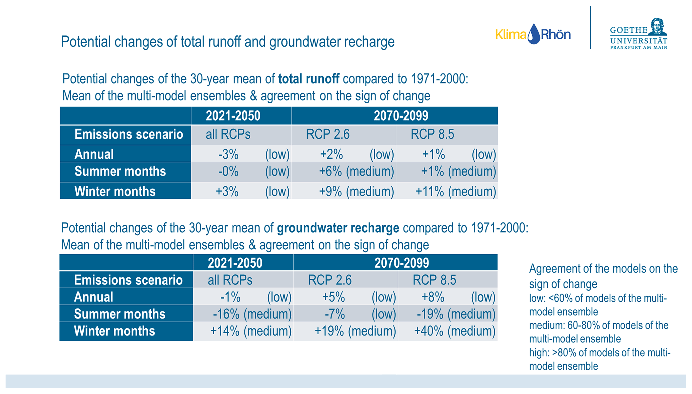

# 4. C5 — Agreement and scenario contrasts

[Collection index](../README.md) · [Research guide](../../wf2-projections-research-guide.md)

## Translate ensemble agreement into a readable summary

An alternative workshop summary of annual and seasonal hydrological changes by horizon and scenario.

**Regional adaptation:** State sign agreement as a contributor count. For scenario contrasts, add
common-membership paired differences; this slide does not provide that diagnostic.

**Source:** Müller and Döll (2024), Quantifying and communicating uncertain climate change hazards in
participatory climate change adaptation processes, Geoscience Communication 7, 121–144. Figure 7.

[Paper and original caption](https://gc.copernicus.org/articles/7/121/2024/) · [Publisher image](https://gc.copernicus.org/articles/7/121/2024/gc-7-121-2024-f07-web.png)

**Rights:** CC BY 4.0; retain third-party credits shown in the article, including the source diagram and logos
in Figure 3.

**File:** 2067 × 1179 pixels; retrieved 2026-10-07; unchanged publisher image.
