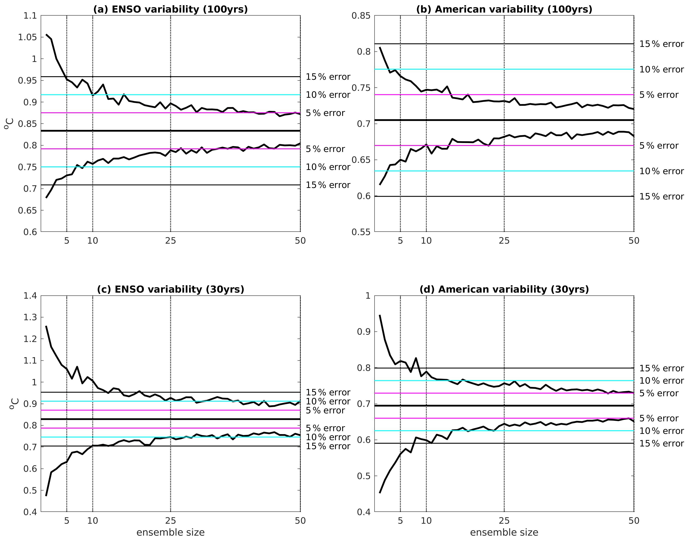
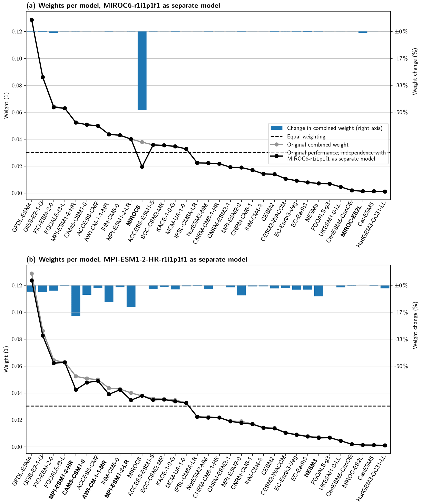

# 4. C6 — Membership, family and window sensitivity

[Collection index](../README.md) · [Research guide](../../wf2-projections-research-guide.md)

## Expose record-length and ensemble-size sensitivity

Variability estimates examined against ensemble size and 30-year versus 100-year records.

**Regional adaptation:** Add a compact sensitivity panel for the suite's actual window choices. Sample-size
sensitivity is distinct from model structural uncertainty.

**Source:** Milinski, Maher and Olonscheck (2020), How large does a large ensemble need to be?, Earth System
Dynamics 11, 885–901. Figure 7.

[Paper and original caption](https://esd.copernicus.org/articles/11/885/2020/) · [Publisher image](https://esd.copernicus.org/articles/11/885/2020/esd-11-885-2020-f07-high-res.png)

**Rights:** CC BY 4.0

**File:** 3289 × 2580 pixels; retrieved 2026-10-07; unchanged publisher image.

## Check sensitivity to ensemble dependence

A controlled dependence experiment showing how weights respond to a member treated as a separate model.

**Regional adaptation:** Compare equal-model, family-aware and leave-family-out summaries; report weight
concentration and changed conclusions.

**Source:** Brunner et al. (2020), Reduced global warming from CMIP6 projections when weighting models by
performance and independence, Earth System Dynamics 11, 995–1012. Figure 6.

[Paper and original caption](https://esd.copernicus.org/articles/11/995/2020/) · [Publisher image](https://esd.copernicus.org/articles/11/995/2020/esd-11-995-2020-f06-web.png)

**Rights:** CC BY 4.0

**File:** 2067 × 2467 pixels; retrieved 2026-10-07; unchanged publisher image.
