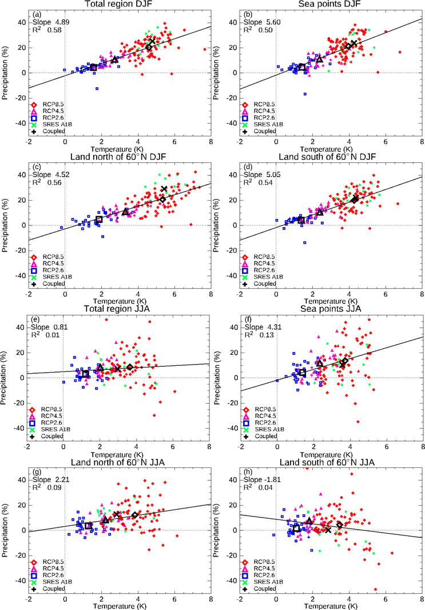

# 4. Cross-component — Paired temperature and precipitation

[Collection index](../README.md) · [Research guide](../../wf2-projections-research-guide.md)

## Preserve the joint temperature-precipitation signal

Paired regional temperature and precipitation changes, faceted by season and spatial support.

**Regional adaptation:** Keep model/member identity paired and add horizon facets. Do not construct a hot-dry
projection by combining marginal quantiles.

**Source:** Christensen, Kjellström, Dieterich, Gröger and Meier (2022), Atmospheric regional climate
projections for the Baltic Sea region until 2100, Earth System Dynamics 13, 133–157. Figure 3.

[Paper and original caption](https://esd.copernicus.org/articles/13/133/2022/) · [Publisher image](https://esd.copernicus.org/articles/13/133/2022/esd-13-133-2022-f03.png)

**Rights:** CC BY 4.0

**File:** 743 × 1064 pixels; retrieved 2026-10-07; unchanged publisher image.
