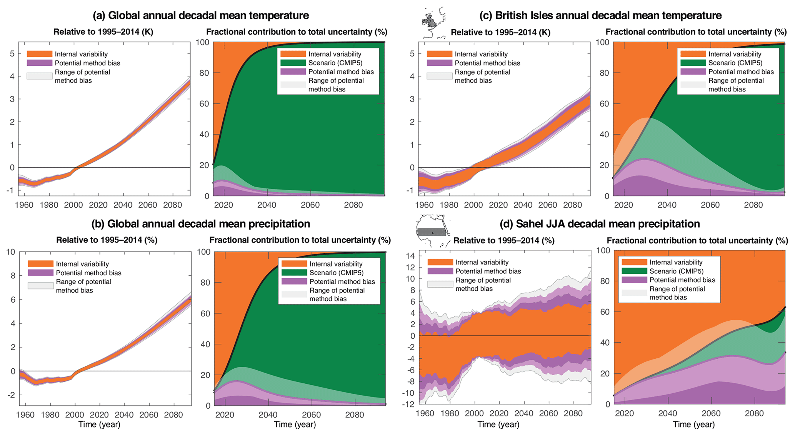

# 5.1 Uncertainty inventory and partitioning

[Collection index](../README.md) · [Research guide](../../wf2-projections-research-guide.md)

## Show why uncertainty depends on region and variable

Global and regional examples combining trajectories with fractional uncertainty components.

**Regional adaptation:** Use regional panels and actual ensemble hierarchy. Component fractions depend on the
partition method; show its assumptions and residual bias.

**Source:** Lehner et al. (2020), Partitioning climate projection uncertainty with multiple large ensembles
and CMIP5/6, Earth System Dynamics 11, 491–508. Figure 5.

[Paper and original caption](https://esd.copernicus.org/articles/11/491/2020/) · [Publisher image](https://esd.copernicus.org/articles/11/491/2020/esd-11-491-2020-f05-web.png)

**Rights:** CC BY 4.0

**File:** 2067 × 1134 pixels; retrieved 2026-10-07; unchanged publisher image.
