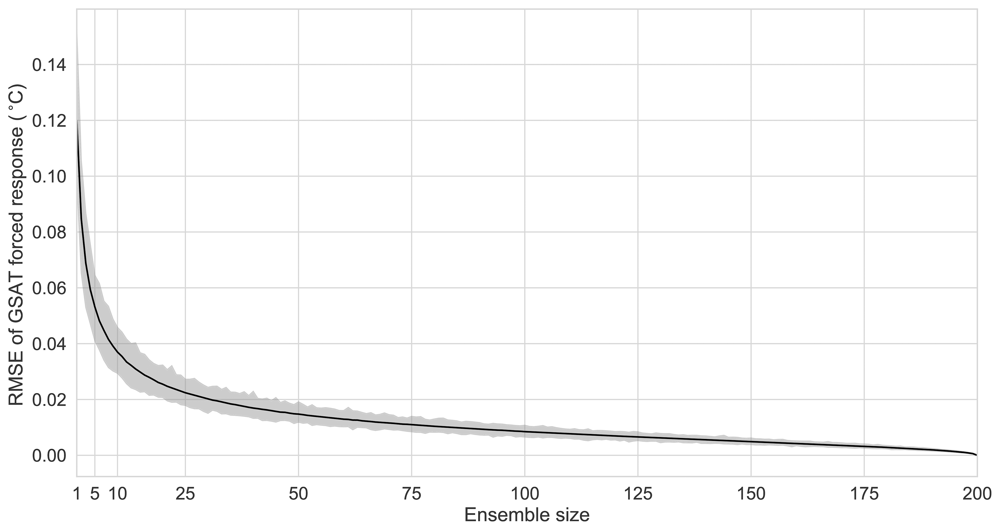

# 5.2 Sampling intervals

[Collection index](../README.md) · [Research guide](../../wf2-projections-research-guide.md)

## Display estimation error rather than only ensemble spread

Error of an estimated forced response as a function of ensemble size.

**Regional adaptation:** This is a member-subsampling example, not a temporal block bootstrap. For finite
climate records, preserve serial dependence and report block/window sensitivity separately.

**Source:** Milinski, Maher and Olonscheck (2020), How large does a large ensemble need to be?, Earth System
Dynamics 11, 885–901. Figure 2.

[Paper and original caption](https://esd.copernicus.org/articles/11/885/2020/) · [Publisher image](https://esd.copernicus.org/articles/11/885/2020/esd-11-885-2020-f02-high-res.png)

**Rights:** CC BY 4.0

**File:** 4202 × 2230 pixels; retrieved 2026-10-07; unchanged publisher image.
