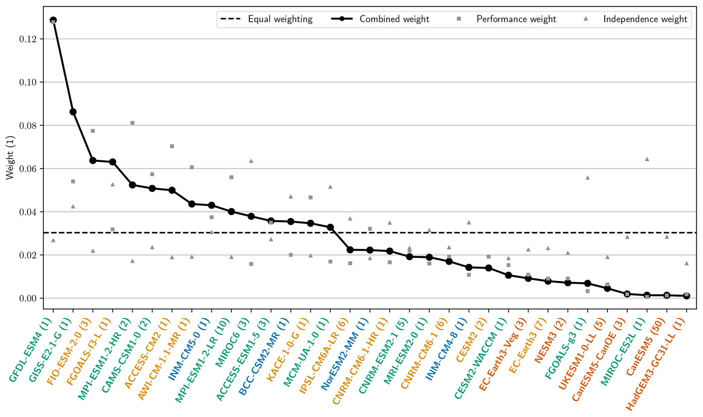
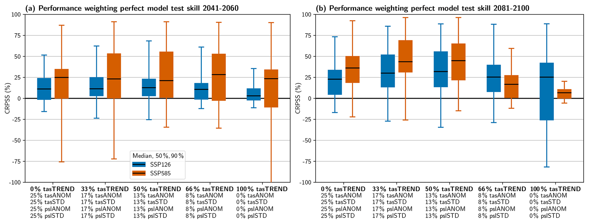

# 5.3 Performance and independence weighting

[Collection index](../README.md) · [Research guide](../../wf2-projections-research-guide.md)

## Make weighting choices inspectable

Performance, independence and combined weights shown against an equal-weight reference.

**Regional adaptation:** Show all weights and their concentration. Diagnostics trained on global temperature
need independent justification for local precipitation or extremes.

**Source:** Brunner et al. (2020), Reduced global warming from CMIP6 projections when weighting models by
performance and independence, Earth System Dynamics 11, 995–1012. Figure 4.

[Paper and original caption](https://esd.copernicus.org/articles/11/995/2020/) · [Publisher image](https://esd.copernicus.org/articles/11/995/2020/esd-11-995-2020-f04-web.png)

**Rights:** CC BY 4.0

**File:** 2067 × 1229 pixels; retrieved 2026-10-07; unchanged publisher image.

## Test whether weighting improves held-out predictions

Perfect-model tests comparing weighting diagnostics and their skill relative to an unweighted ensemble.

**Regional adaptation:** Prefer held-out families and independent observations when possible; keep the
unweighted regional result visible.

**Source:** Brunner et al. (2020), Reduced global warming from CMIP6 projections when weighting models by
performance and independence, Earth System Dynamics 11, 995–1012. Figure 1.

[Paper and original caption](https://esd.copernicus.org/articles/11/995/2020/) · [Publisher image](https://esd.copernicus.org/articles/11/995/2020/esd-11-995-2020-f01-web.png)

**Rights:** CC BY 4.0

**File:** 2067 × 788 pixels; retrieved 2026-10-07; unchanged publisher image.
