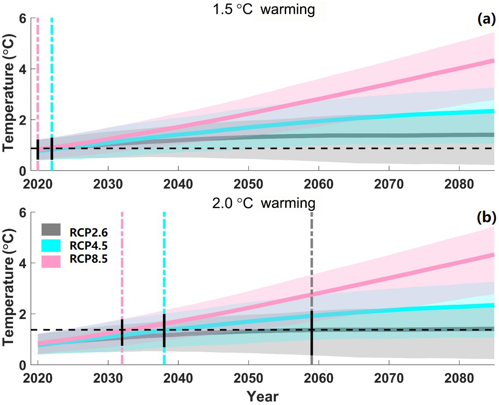
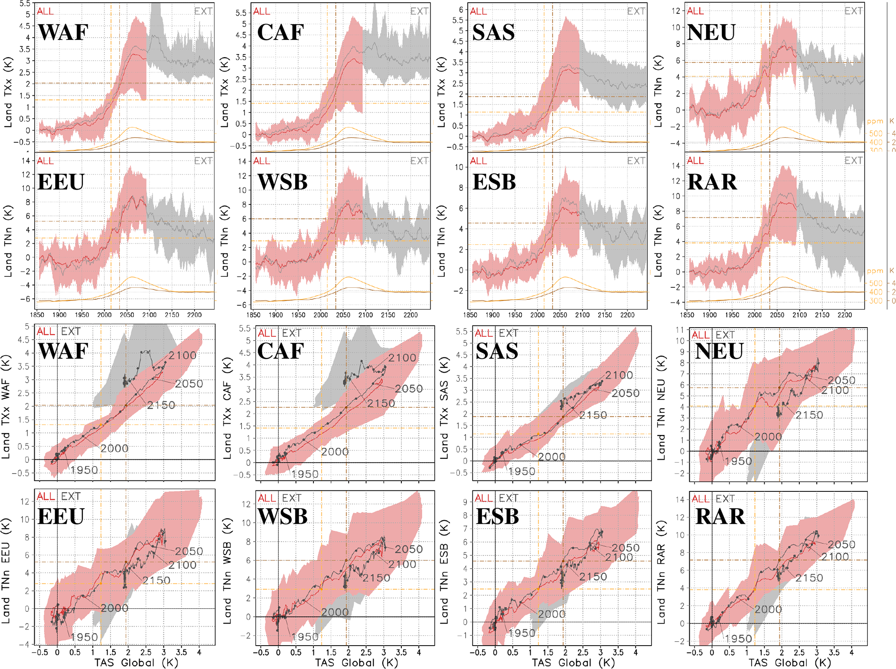

# 6.1 Global warming levels and pathway dependence

[Collection index](../README.md) · [Research guide](../../wf2-projections-research-guide.md)

## Connect warming levels to scenario-dependent dates

Scenario warming trajectories with crossing dates for selected global temperature levels.

**Regional adaptation:** Implement crossings per model/member, not from a scenario-mean curve. Document the
global baseline and crossing rule; record unreached levels explicitly.

**Source:** Gu, Chen, Yin, Sullivan, Wang, Guo, Zhang and Kim (2020), Projected increases in magnitude and
socioeconomic exposure of global droughts in 1.5 and 2 °C warmer climates, Hydrology and Earth System Sciences
24, 451–472. Figure 1.

[Paper and original caption](https://hess.copernicus.org/articles/24/451/2020/) · [Publisher image](https://hess.copernicus.org/articles/24/451/2020/hess-24-451-2020-f01.png)

**Rights:** CC BY 4.0

**File:** 1144 × 928 pixels; retrieved 2026-10-07; unchanged publisher image.

## Show that equal warming need not imply equal regional conditions

Regional extreme-temperature trajectories plotted against both time and global temperature on an overshoot
pathway.

**Regional adaptation:** Retain warming and cooling branches; do not average them together. Use this as a
path-dependence diagnostic.

**Source:** Roldán-Gómez, De Luca, Bernardello and Donat (2025), Regional irreversibility of mean and extreme
surface air temperature and precipitation in CMIP6 overshoot scenarios associated with interhemispheric
temperature asymmetries, Earth System Dynamics 16, 1–27. Figure 8.

[Paper and original caption](https://esd.copernicus.org/articles/16/1/2025/) · [Publisher image](https://esd.copernicus.org/articles/16/1/2025/esd-16-1-2025-f08.png)

**Rights:** CC BY 4.0

**File:** 2067 × 1544 pixels; retrieved 2026-10-07; unchanged publisher image.
