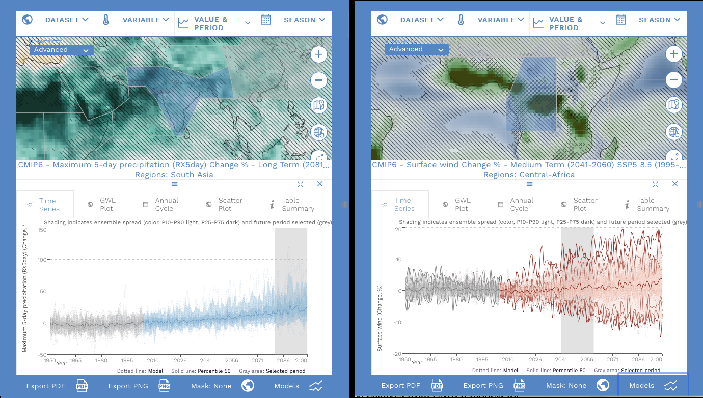

# 6.2 Map robustness

[Collection index](../README.md) · [Research guide](../../wf2-projections-research-guide.md)

## Compare robustness at grid and regional scales

IPCC assessment example of precipitation-extreme change and robustness across spatial scales.

**Regional adaptation:** Keep agreement, detectability and data coverage distinct. Use the documented
robustness rules from the guide, with explicit contributor counts.

**Source:** IPCC (2021), Climate Change 2021: The Physical Science Basis, Working Group I contribution to the
Sixth Assessment Report, Atlas, Figure Atlas.9, Cambridge University Press. Figure Atlas.9.

[Paper and original caption](https://www.ipcc.ch/report/ar6/wg1/chapter/atlas/) · [Publisher image](https://www.ipcc.ch/report/ar6/wg1/downloads/figures/IPCC_AR6_WGI_Atlas_Figure_9.png)

**Rights:** IPCC copyright; unmodified limited reproduction for personal non-commercial use with full
attribution. Do not redistribute or adapt this image under CC BY. See https://www.ipcc.ch/copyright/.

**File:** 1380 × 782 pixels; retrieved 2026-10-07; unchanged publisher image.
