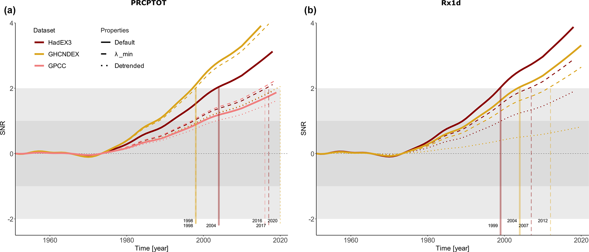

# 6.3 Time of emergence

[Collection index](../README.md) · [Research guide](../../wf2-projections-research-guide.md)

## Make the emergence threshold visible

Signal-to-noise trajectories with a threshold and alternative observational/method choices.

**Regional adaptation:** This is global observational detection. For a catchment projection, define local
signal, noise, persistence and non-emergence explicitly.

**Source:** de Vries, Sippel, Pendergrass and Knutti (2023), Robust global detection of forced changes in mean
and extreme precipitation despite observational disagreement on the magnitude of change, Earth System Dynamics
14, 81–100. Figure 5.

[Paper and original caption](https://esd.copernicus.org/articles/14/81/2023/) · [Publisher image](https://esd.copernicus.org/articles/14/81/2023/esd-14-81-2023-f05.png)

**Rights:** CC BY 4.0

**File:** 2067 × 886 pixels; retrieved 2026-10-07; unchanged publisher image.
