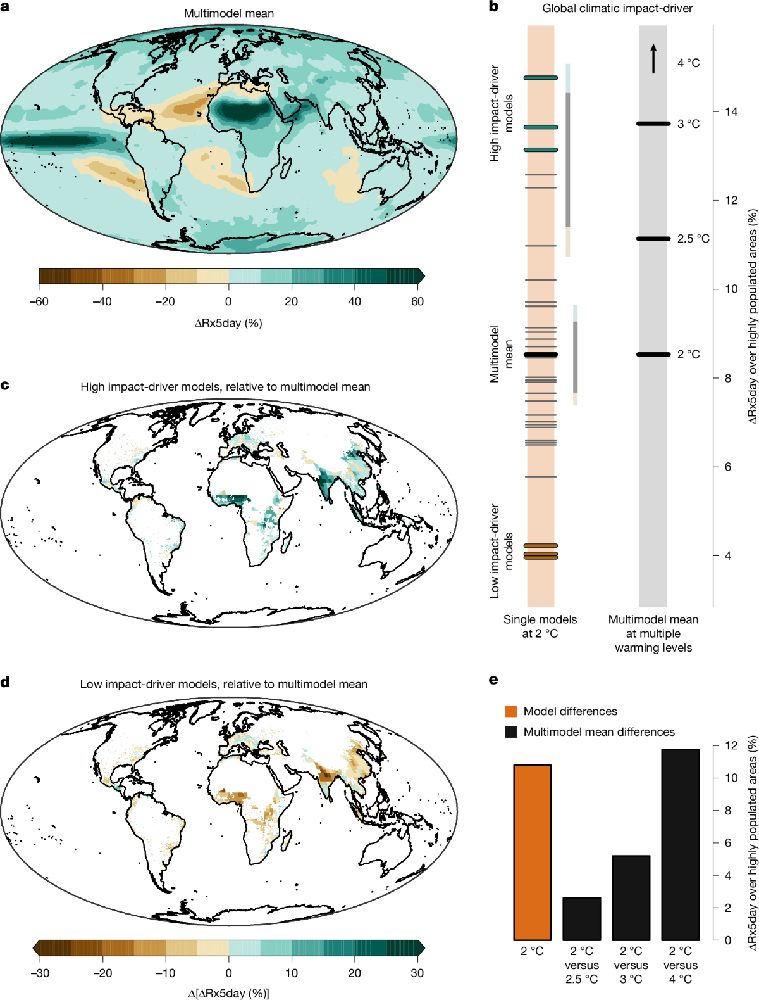

# 7.1 Daily extremes

[Collection index](../README.md) · [Research guide](../../wf2-projections-research-guide.md)

## Compare extreme-precipitation outcomes at a warming level

Rx5day changes with multimodel summaries and coherent selected-model extreme outcomes.

**Regional adaptation:** Use daily inputs and fixed indicator definitions. A precipitation extreme is a hazard
indicator, not an estimate of local flood damage.

**Source:** Bevacqua, Fischer, Sillmann and Zscheischler (2026), Moderate global warming does not rule out
extreme global climate outcomes, Nature. Figure 2.

[Paper and original caption](https://www.nature.com/articles/s41586-026-10237-9) · [Publisher image](https://media.springernature.com/lw1200/springer-static/image/art%3A10.1038%2Fs41586-026-10237-9/MediaObjects/41586_2026_10237_Fig2_HTML.png)

**Rights:** CC BY 4.0

**File:** 1200 × 1579 pixels; retrieved 2026-10-07; unchanged publisher image.
