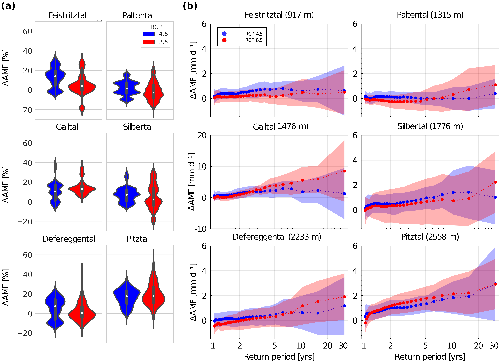
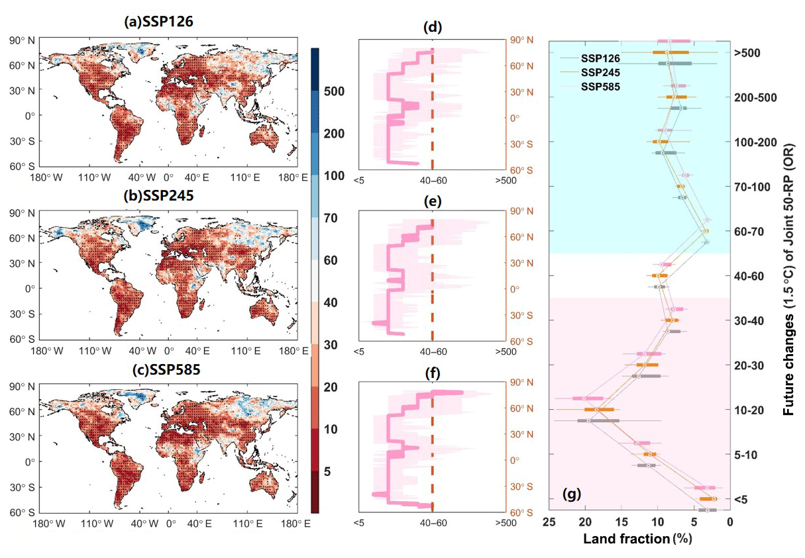
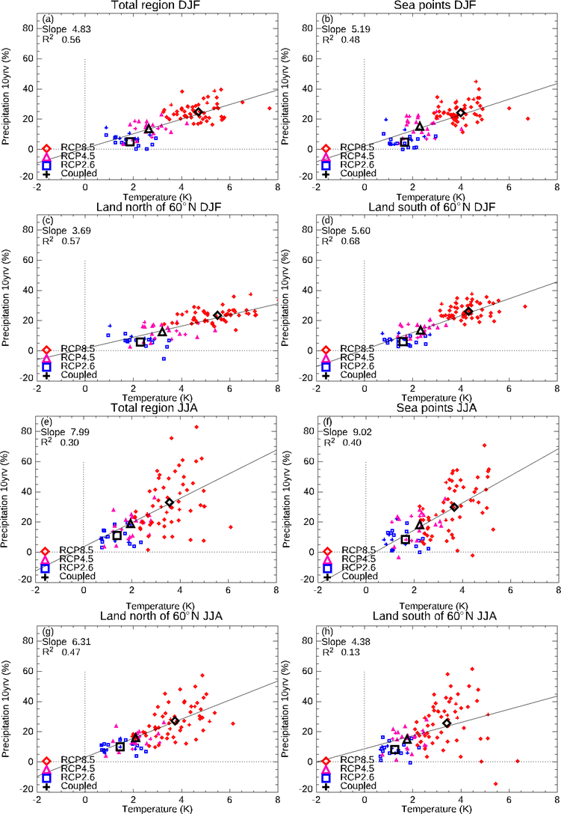

# 7.2 Extreme-event frequency and return levels

[Collection index](../README.md) · [Research guide](../../wf2-projections-research-guide.md)

## Show how the change depends on event rarity

Catchment flood-magnitude changes against return period, with ensemble spread.

**Regional adaptation:** A hydrological analogue for climate-extreme curves. State the fitting model, sample
length and interval meaning; avoid extrapolating rare tails without support.

**Source:** Hanus, Hrachowitz, Zekollari, Schoups, Vizcaino and Kaitna (2021), Future changes in annual,
seasonal and monthly runoff signatures in contrasting Alpine catchments in Austria, Hydrology and Earth System
Sciences 25, 3429–3453. Figure 12.

[Paper and original caption](https://hess.copernicus.org/articles/25/3429/2021/) · [Publisher image](https://hess.copernicus.org/articles/25/3429/2021/hess-25-3429-2021-f12-high-res.png)

**Rights:** CC BY 4.0

**File:** 5404 × 3919 pixels; retrieved 2026-10-07; unchanged publisher image.

## Hold the reference event fixed when comparing frequency

Maps of future joint return periods for a reference drought event.

**Regional adaptation:** Distinguish joint and marginal return periods, and define the exceedance event. An
event's future frequency differs from its future return-level magnitude.

**Source:** Gu, Chen, Yin, Sullivan, Wang, Guo, Zhang and Kim (2020), Projected increases in magnitude and
socioeconomic exposure of global droughts in 1.5 and 2 °C warmer climates, Hydrology and Earth System Sciences
24, 451–472. Figure 7.

[Paper and original caption](https://hess.copernicus.org/articles/24/451/2020/) · [Publisher image](https://hess.copernicus.org/articles/24/451/2020/hess-24-451-2020-f07-web.png)

**Rights:** CC BY 4.0

**File:** 1215 × 843 pixels; retrieved 2026-10-07; unchanged publisher image.

## Retain paired warming and precipitation return-level changes

Regional changes in a daily-precipitation 10-year return level plotted against temperature change.

**Regional adaptation:** Label the fitted distribution and reference event. Preserve each model's paired
values and report finite-record sampling intervals separately from model spread.

**Source:** Christensen, Kjellström, Dieterich, Gröger and Meier (2022), Atmospheric regional climate
projections for the Baltic Sea region until 2100, Earth System Dynamics 13, 133–157. Figure 4.

[Paper and original caption](https://esd.copernicus.org/articles/13/133/2022/) · [Publisher image](https://esd.copernicus.org/articles/13/133/2022/esd-13-133-2022-f04.png)

**Rights:** CC BY 4.0

**File:** 751 × 1087 pixels; retrieved 2026-10-07; unchanged publisher image.
