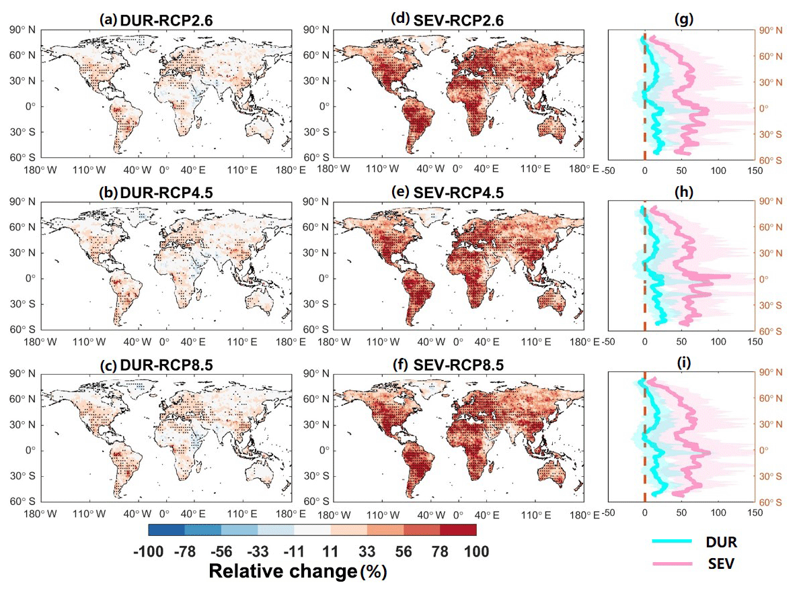
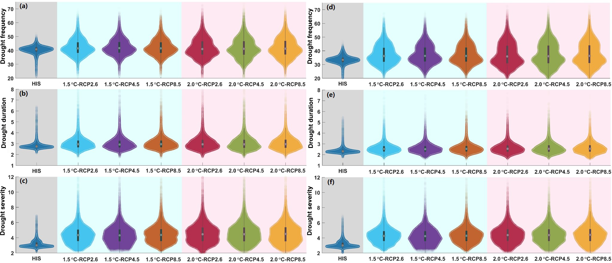

# 7.3 Drought and climatic water balance

[Collection index](../README.md) · [Research guide](../../wf2-projections-research-guide.md)

## Show drought duration and severity separately

Paired maps of drought duration and severity changes derived from SPEI.

**Regional adaptation:** Use a fixed reference fit and documented PET method; show precipitation-only and
water-balance indicators together.

**Source:** Gu, Chen, Yin, Sullivan, Wang, Guo, Zhang and Kim (2020), Projected increases in magnitude and
socioeconomic exposure of global droughts in 1.5 and 2 °C warmer climates, Hydrology and Earth System Sciences
24, 451–472. Figure 4.

[Paper and original caption](https://hess.copernicus.org/articles/24/451/2020/) · [Publisher image](https://hess.copernicus.org/articles/24/451/2020/hess-24-451-2020-f04-web.png)

**Rights:** CC BY 4.0

**File:** 1185 × 880 pixels; retrieved 2026-10-07; unchanged publisher image.

## Show how drought definitions affect results

Comparison of drought-characteristic distributions under alternative detection thresholds.

**Regional adaptation:** Label whether distributions are across locations, years or models. Spatial
distributions of ensemble-mean results are not model uncertainty.

**Source:** Gu, Chen, Yin, Sullivan, Wang, Guo, Zhang and Kim (2020), Projected increases in magnitude and
socioeconomic exposure of global droughts in 1.5 and 2 °C warmer climates, Hydrology and Earth System Sciences
24, 451–472. Figure 13.

[Paper and original caption](https://hess.copernicus.org/articles/24/451/2020/) · [Publisher image](https://hess.copernicus.org/articles/24/451/2020/hess-24-451-2020-f13.png)

**Rights:** CC BY 4.0

**File:** 2045 × 880 pixels; retrieved 2026-10-07; unchanged publisher image.
