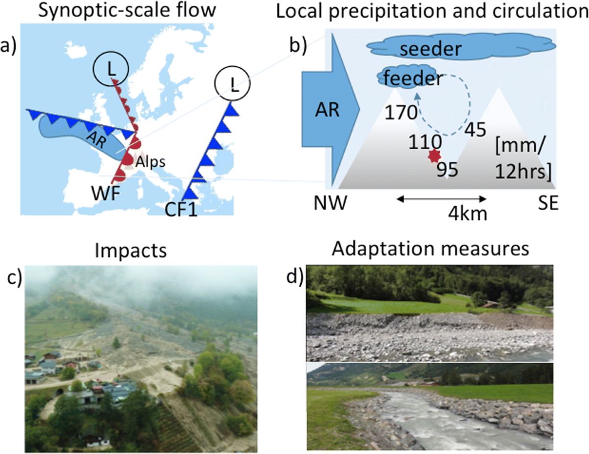
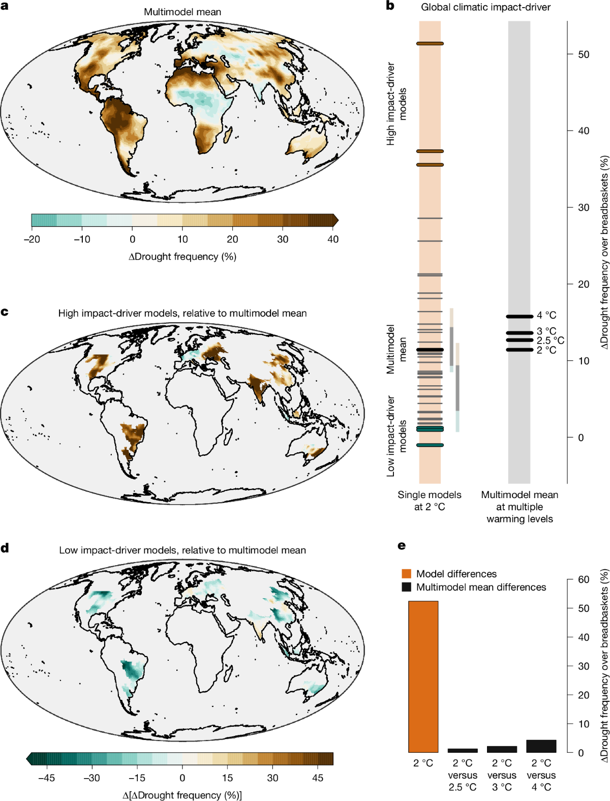

# 7.4 Compound hazards, concurrence and sequencing

[Collection index](../README.md) · [Research guide](../../wf2-projections-research-guide.md)

## Explain a compound event through its physical sequence

An Alpine rain-on-snow event connecting synoptic conditions, temperature, rainfall and snow.

**Regional adaptation:** Use an event timeline plus process sketch for local storylines; estimate occurrence
frequencies separately from the conditional narrative.

**Source:** Shepherd et al. (2018), Storylines: an alternative approach to representing uncertainty in
physical aspects of climate change, Climatic Change 151, 555–571. Figure 1.

[Paper and original caption](https://link.springer.com/article/10.1007/s10584-018-2317-9) · [Publisher image](https://media.springernature.com/lw1200/springer-static/image/art%3A10.1007%2Fs10584-018-2317-9/MediaObjects/10584_2018_2317_Fig1_HTML.png)

**Rights:** Article: CC BY 4.0. Figure 1 includes separately credited photographs: panel c, Bern cantonal
police, used with permission; panel d, a credited external website. Do not assume those photographs can be
redistributed under the article license. Saved whole and unchanged for personal research reference.

**File:** 1200 × 925 pixels; retrieved 2026-10-07; unchanged publisher image.

## Keep spatially concurrent drought fields coherent

Drought-frequency outcomes across breadbasket regions using coherent model fields.

**Regional adaptation:** For multi-catchment exposure, retain the same model/member across all locations.
Location-by-location worst cases may never occur together.

**Source:** Bevacqua, Fischer, Sillmann and Zscheischler (2026), Moderate global warming does not rule out
extreme global climate outcomes, Nature. Figure 3.

[Paper and original caption](https://www.nature.com/articles/s41586-026-10237-9) · [Publisher image](https://media.springernature.com/lw1200/springer-static/image/art%3A10.1038%2Fs41586-026-10237-9/MediaObjects/41586_2026_10237_Fig3_HTML.png)

**Rights:** CC BY 4.0

**File:** 1200 × 1576 pixels; retrieved 2026-10-07; unchanged publisher image.
