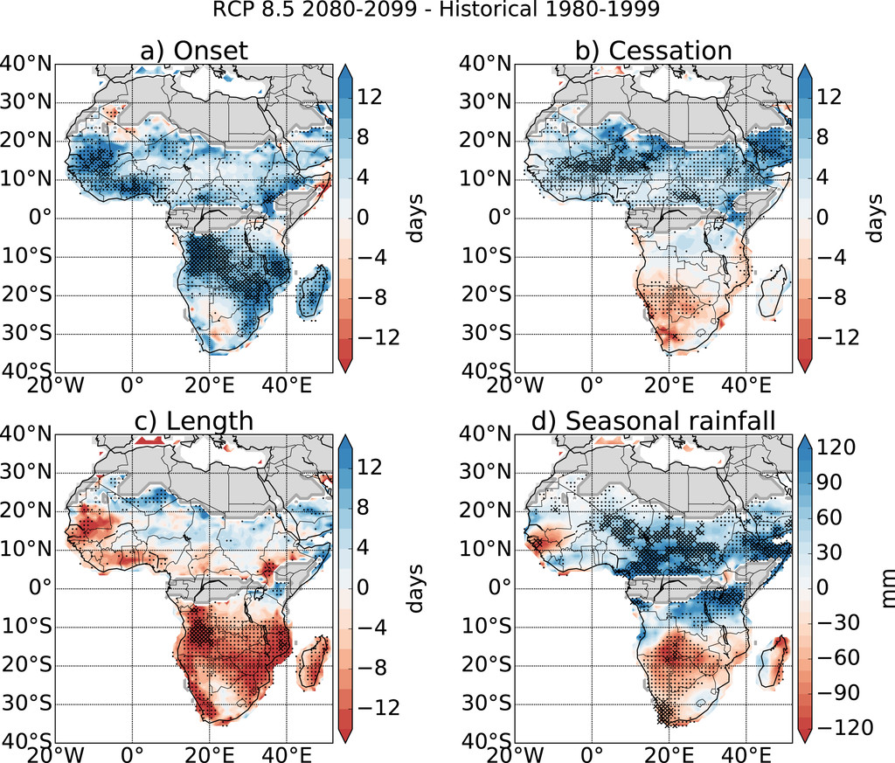
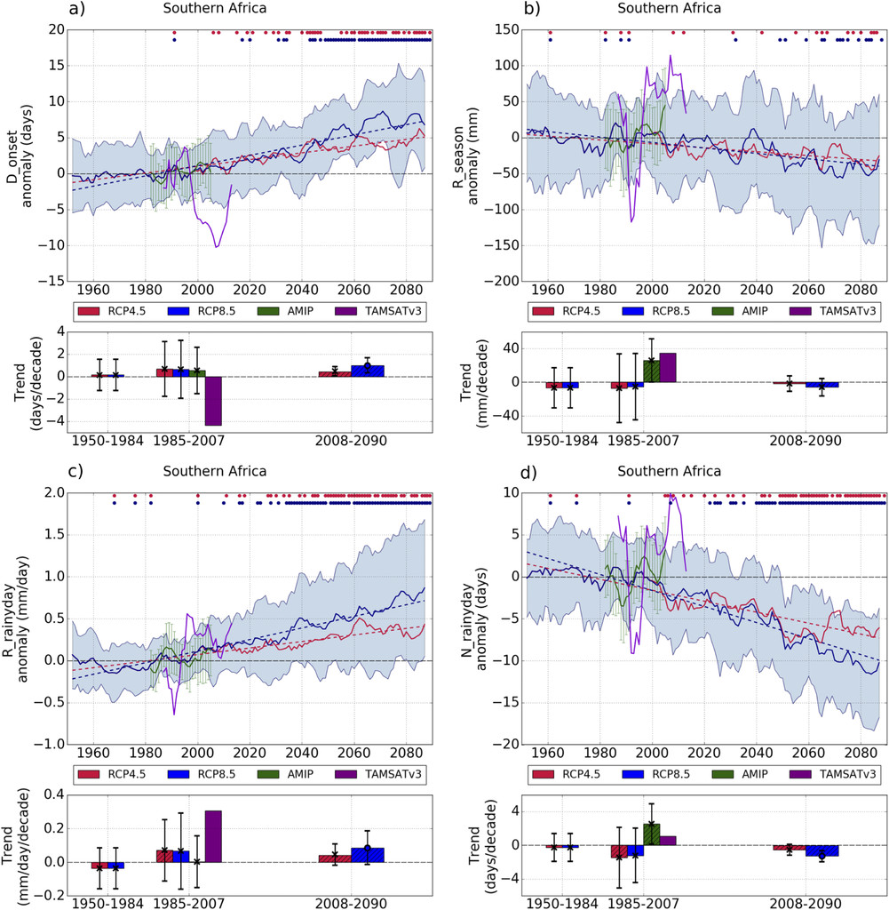

# 7.5 Season timing

[Collection index](../README.md) · [Research guide](../../wf2-projections-research-guide.md)

## Distinguish timing, length and amount

Wet-season onset, cessation, length and rainfall amount shown as separate mapped changes.

**Regional adaptation:** Use locally meaningful season definitions. A timing shift is not equivalent to a
change in rainfall during fixed calendar months.

**Source:** Dunning, Black and Allan (2018), Later wet seasons with more intense rainfall over Africa under
future climate change, Journal of Climate 31, 9719–9738. Figure 1.

[Paper and original caption](https://journals.ametsoc.org/view/journals/clim/31/23/jcli-d-18-0102.1.xml) · [Publisher image](https://journals.ametsoc.org/view/journals/clim/31/23/full-jcli-d-18-0102.1-f1.jpg)

**Rights:** © 2018 American Meteorological Society. Open access is stated, but the publisher page does not
grant a CC license. Saved for personal research reference; redistribution/adaptation permission has not been
verified. Publisher reuse-policy page was blocked.

**File:** 1024 × 873 pixels; retrieved 2026-10-07; unchanged publisher image.

## Link a regional timing shift to rainy-day characteristics

Regional trajectories of onset, total rain, wet-day intensity and wet-day count.

**Regional adaptation:** Use daily data for onset and wet-day metrics; label smoothing and replace the single
spread band with clearly separated scenario distributions if needed.

**Source:** Dunning, Black and Allan (2018), Later wet seasons with more intense rainfall over Africa under
future climate change, Journal of Climate 31, 9719–9738. Figure 3.

[Paper and original caption](https://journals.ametsoc.org/view/journals/clim/31/23/jcli-d-18-0102.1.xml) · [Publisher image](https://journals.ametsoc.org/view/journals/clim/31/23/full-jcli-d-18-0102.1-f3.jpg)

**Rights:** © 2018 American Meteorological Society. Open access is stated, but the publisher page does not
grant a CC license. Saved for personal research reference; redistribution/adaptation permission has not been
verified. Publisher reuse-policy page was blocked.

**File:** 1001 × 1024 pixels; retrieved 2026-10-07; unchanged publisher image.
