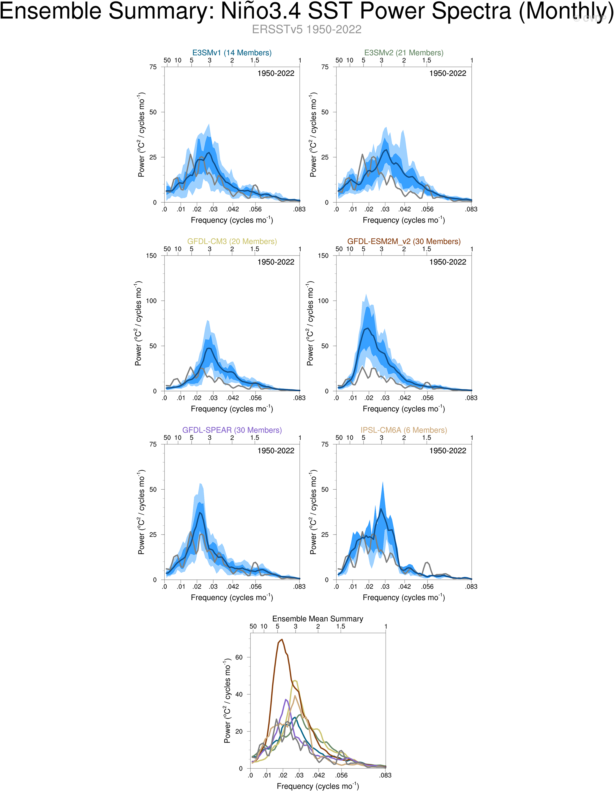
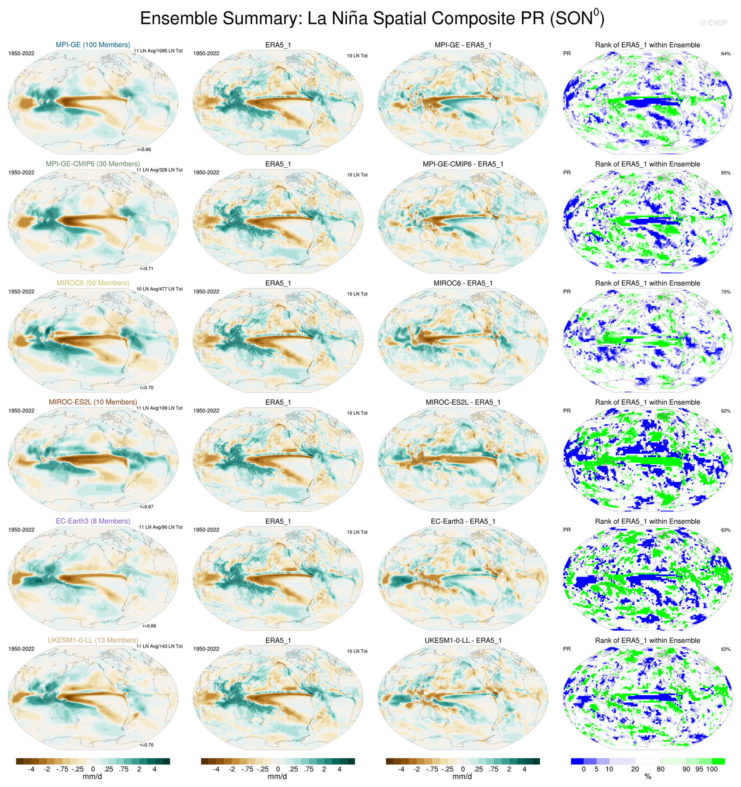

# 7.6 Climate modes and teleconnections

[Collection index](../README.md) · [Research guide](../../wf2-projections-research-guide.md)

## Evaluate the timescales of a climate mode

ENSO power spectra comparing model ensembles and observations.

**Regional adaptation:** Pair spectral diagnostics with regional teleconnections; global mode skill alone does
not establish local seasonal rainfall skill.

**Source:** Maher et al. (2025), The updated Multi-Model Large Ensemble Archive and the Climate Variability
Diagnostics Package: new tools for the study of climate variability and change, Geoscientific Model
Development 18, 6341–6365. Figure 6.

[Paper and original caption](https://gmd.copernicus.org/articles/18/6341/2025/) · [Publisher image](https://gmd.copernicus.org/articles/18/6341/2025/gmd-18-6341-2025-f06.png)

**Rights:** CC BY 4.0

**File:** 2067 × 2659 pixels; retrieved 2026-10-07; unchanged publisher image.

## Compare teleconnection patterns with observational uncertainty

La Niña precipitation composites, model-observation differences and observed ranks in model ensembles.

**Regional adaptation:** For a local summary, add season-specific regional effects with event counts.
Distinguish changed mode amplitude from changed teleconnection strength.

**Source:** Maher et al. (2025), The updated Multi-Model Large Ensemble Archive and the Climate Variability
Diagnostics Package: new tools for the study of climate variability and change, Geoscientific Model
Development 18, 6341–6365. Figure 7.

[Paper and original caption](https://gmd.copernicus.org/articles/18/6341/2025/) · [Publisher image](https://gmd.copernicus.org/articles/18/6341/2025/gmd-18-6341-2025-f07-web.jpg)

**Rights:** CC BY 4.0

**File:** 1892 × 2008 pixels; retrieved 2026-10-07; unchanged publisher image.
