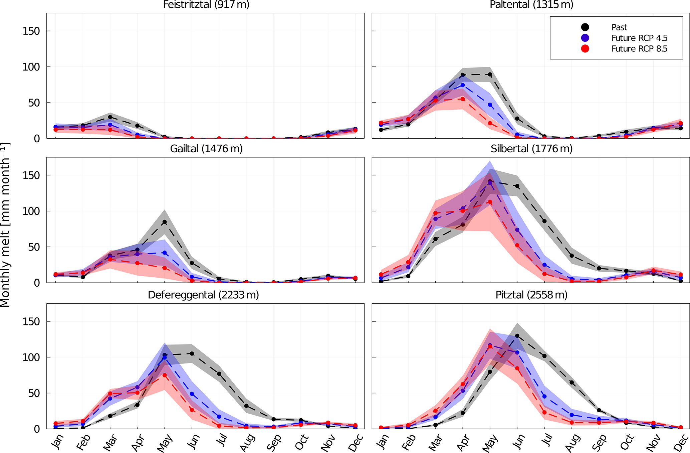
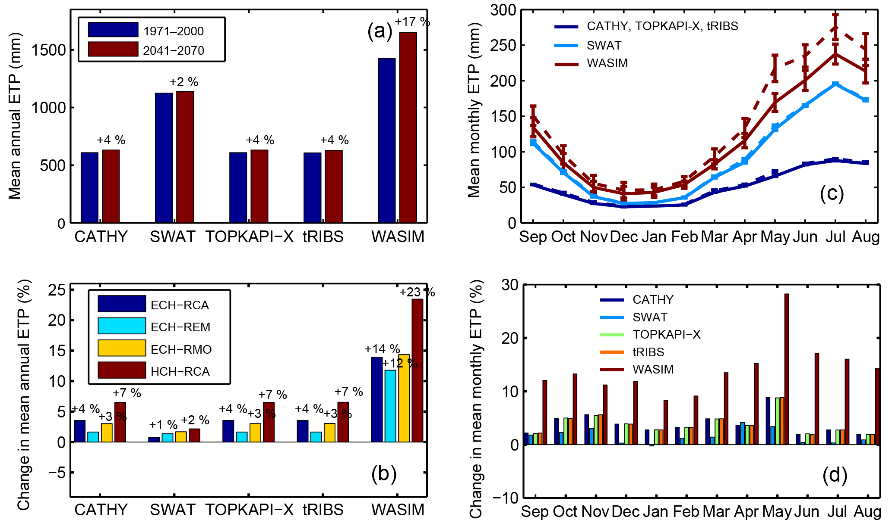

# 7.7 Snow and evaporative demand

[Collection index](../README.md) · [Research guide](../../wf2-projections-research-guide.md)

## Connect changing snow storage to seasonal water supply

Monthly melt contributions for historical and future catchment conditions.

**Regional adaptation:** Retain elevation and snow regime context. Snowmelt projections require snow/process
information beyond monthly temperature and precipitation alone.

**Source:** Hanus, Hrachowitz, Zekollari, Schoups, Vizcaino and Kaitna (2021), Future changes in annual,
seasonal and monthly runoff signatures in contrasting Alpine catchments in Austria, Hydrology and Earth System
Sciences 25, 3429–3453. Figure 10.

[Paper and original caption](https://hess.copernicus.org/articles/25/3429/2021/) · [Publisher image](https://hess.copernicus.org/articles/25/3429/2021/hess-25-3429-2021-f10.png)

**Rights:** CC BY 4.0

**File:** 2067 × 1356 pixels; retrieved 2026-10-07; unchanged publisher image.

## Expose differences in evaporative-demand estimates

Annual, monthly and model-specific potential evapotranspiration comparisons.

**Regional adaptation:** Document the PET formulation and required meteorological variables. PET is
atmospheric demand and cannot be equated with actual evapotranspiration.

**Source:** Perra, Piras, Deidda, Paniconi, Mascaro, Vivoni, Cau, Marras, Ludwig and Meyer (2018), Multimodel
assessment of climate change-induced hydrologic impacts for a Mediterranean catchment, Hydrology and Earth
System Sciences 22, 4125–4143. Figure 6.

[Paper and original caption](https://hess.copernicus.org/articles/22/4125/2018/) · [Publisher image](https://hess.copernicus.org/articles/22/4125/2018/hess-22-4125-2018-f06-web.png)

**Rights:** CC BY 4.0

**File:** 2066 × 1221 pixels; retrieved 2026-10-07; unchanged publisher image.
