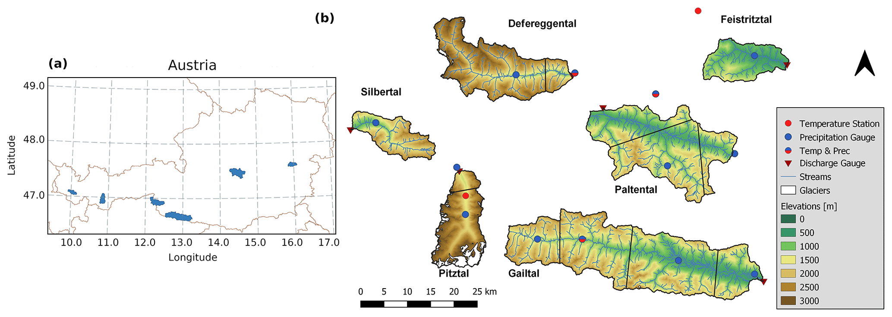
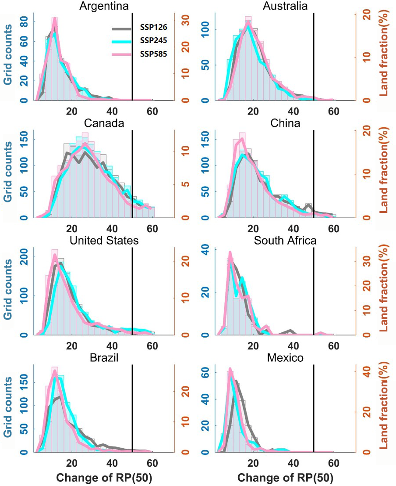

# 8.1 Catchments, subcatchments and national support

[Collection index](../README.md) · [Research guide](../../wf2-projections-research-guide.md)

## Give each regional result a spatial-support context

Catchment boundaries, elevation, observation stations and precipitation zones.

**Regional adaptation:** Add source-grid footprints and effective cell counts for projections; distinguish
catchments, subcatchments and station observations.

**Source:** Hanus, Hrachowitz, Zekollari, Schoups, Vizcaino and Kaitna (2021), Future changes in annual,
seasonal and monthly runoff signatures in contrasting Alpine catchments in Austria, Hydrology and Earth System
Sciences 25, 3429–3453. Figure 1.

[Paper and original caption](https://hess.copernicus.org/articles/25/3429/2021/) · [Publisher image](https://hess.copernicus.org/articles/25/3429/2021/hess-25-3429-2021-f01-web.png)

**Rights:** CC BY 4.0

**File:** 2067 × 736 pixels; retrieved 2026-10-07; unchanged publisher image.

## Compare national distributions with clear denominators

Country panels showing spatial distributions of changes in a reference drought event's return period.

**Regional adaptation:** These distributions are across grid cells, not climate models. State the spatial
denominator and keep physical hazard separate from population/GDP exposure.

**Source:** Gu, Chen, Yin, Sullivan, Wang, Guo, Zhang and Kim (2020), Projected increases in magnitude and
socioeconomic exposure of global droughts in 1.5 and 2 °C warmer climates, Hydrology and Earth System Sciences
24, 451–472. Figure 11.

[Paper and original caption](https://hess.copernicus.org/articles/24/451/2020/) · [Publisher image](https://hess.copernicus.org/articles/24/451/2020/hess-24-451-2020-f11.png)

**Rights:** CC BY 4.0

**File:** 904 × 1107 pixels; retrieved 2026-10-07; unchanged publisher image.
