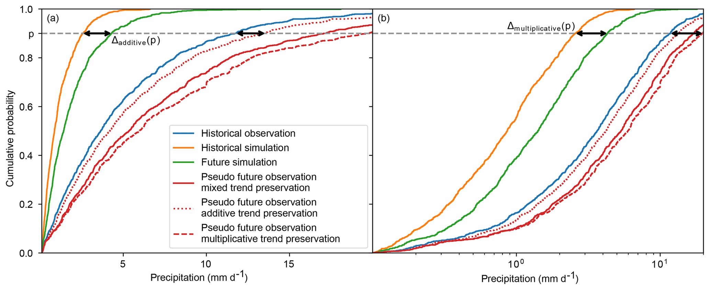
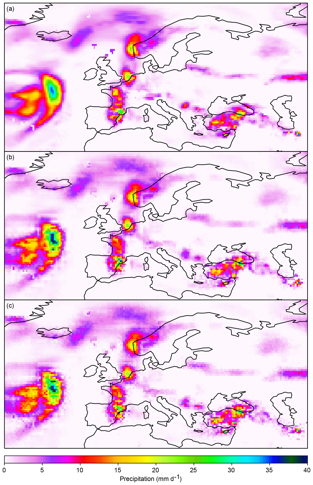
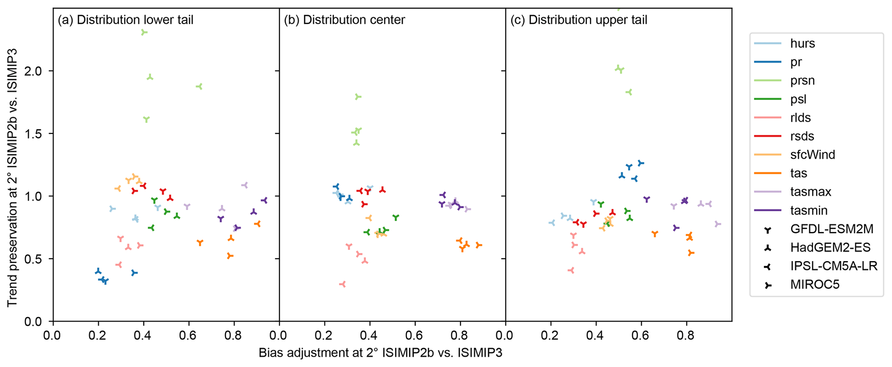

# 8.2 Regridding, bias adjustment and downscaling

[Collection index](../README.md) · [Research guide](../../wf2-projections-research-guide.md)

## Explain what bias adjustment preserves

CDF schematics illustrating alternative transfers of a simulated change signal to observations.

**Regional adaptation:** State whether changes are additive, multiplicative or mixed. Evaluate tails, wet-day
frequency and dependence separately.

**Source:** Lange (2019), Trend-preserving bias adjustment and statistical downscaling with ISIMIP3BASD
(v1.0), Geoscientific Model Development 12, 3055–3070. Figure 1.

[Paper and original caption](https://gmd.copernicus.org/articles/12/3055/2019/) · [Publisher image](https://gmd.copernicus.org/articles/12/3055/2019/gmd-12-3055-2019-f01-web.png)

**Rights:** CC BY 4.0

**File:** 2067 × 847 pixels; retrieved 2026-10-07; unchanged publisher image.

## Check the spatial structures introduced by downscaling

Comparison of precipitation fields produced by different downscaling steps.

**Regional adaptation:** Use matched GCM/member/time inputs. Inspect catchment totals and cross-catchment
dependence; finer grids alone do not demonstrate added skill.

**Source:** Lange (2019), Trend-preserving bias adjustment and statistical downscaling with ISIMIP3BASD
(v1.0), Geoscientific Model Development 12, 3055–3070. Figure 5.

[Paper and original caption](https://gmd.copernicus.org/articles/12/3055/2019/) · [Publisher image](https://gmd.copernicus.org/articles/12/3055/2019/gmd-12-3055-2019-f05-web.png)

**Rights:** CC BY 4.0

**File:** 2067 × 3200 pixels; retrieved 2026-10-07; unchanged publisher image.

## Show the tradeoff between adjustment and change preservation

A performance comparison separating correction of historical distributions from preservation of trends.

**Regional adaptation:** Repeat relevant diagnostics by region, season and variable with held-out data; a
method that adjusts means can still damage extremes or dependence.

**Source:** Lange (2019), Trend-preserving bias adjustment and statistical downscaling with ISIMIP3BASD
(v1.0), Geoscientific Model Development 12, 3055–3070. Figure 7.

[Paper and original caption](https://gmd.copernicus.org/articles/12/3055/2019/) · [Publisher image](https://gmd.copernicus.org/articles/12/3055/2019/gmd-12-3055-2019-f07-web.png)

**Rights:** CC BY 4.0

**File:** 2067 × 853 pixels; retrieved 2026-10-07; unchanged publisher image.
