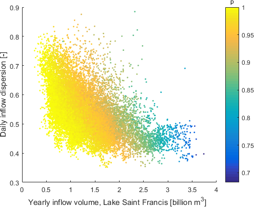
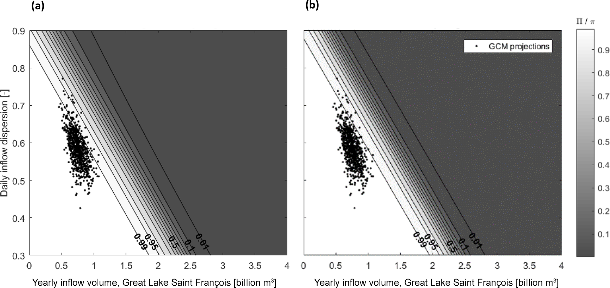

# 9. Projection overlays, vulnerability and storylines

[Collection index](../README.md) · [Research guide](../../wf2-projections-research-guide.md)

## Start with system performance across stressors

A bottom-up flood-control response surface, with reliability shown across two inflow stressors.

**Regional adaptation:** Add the decision threshold. These axes are inflow volume and dispersion, not
temperature and precipitation: use a response surface in the independently selected CST stressors and retain
its reference definitions.

**Source:** Lachaut and Tilmant (2021), Possibilistic response surfaces: incorporating fuzzy thresholds into
bottom-up flood vulnerability analysis, Hydrology and Earth System Sciences 25, 6421–6435. Figure 6.

[Paper and original caption](https://hess.copernicus.org/articles/25/6421/2021/) · [Publisher image](https://hess.copernicus.org/articles/25/6421/2021/hess-25-6421-2021-f06.png)

**Rights:** CC BY 4.0

**File:** 495 × 403 pixels; retrieved 2026-10-07; unchanged publisher image.

## Place projection evidence over a vulnerability domain

GCM-derived projection points over alternative fitted representations of an acceptability domain in inflow
space.

**Regional adaptation:** Map projections into exactly the same stressors and reference definitions as the
response surface; do not plot WF2 temperature/precipitation changes directly on these inflow axes. Point
density is not calibrated climate probability.

**Source:** Lachaut and Tilmant (2021), Possibilistic response surfaces: incorporating fuzzy thresholds into
bottom-up flood vulnerability analysis, Hydrology and Earth System Sciences 25, 6421–6435. Figure 8.

[Paper and original caption](https://hess.copernicus.org/articles/25/6421/2021/) · [Publisher image](https://hess.copernicus.org/articles/25/6421/2021/hess-25-6421-2021-f08.png)

**Rights:** CC BY 4.0

**File:** 2066 × 979 pixels; retrieved 2026-10-07; unchanged publisher image.
