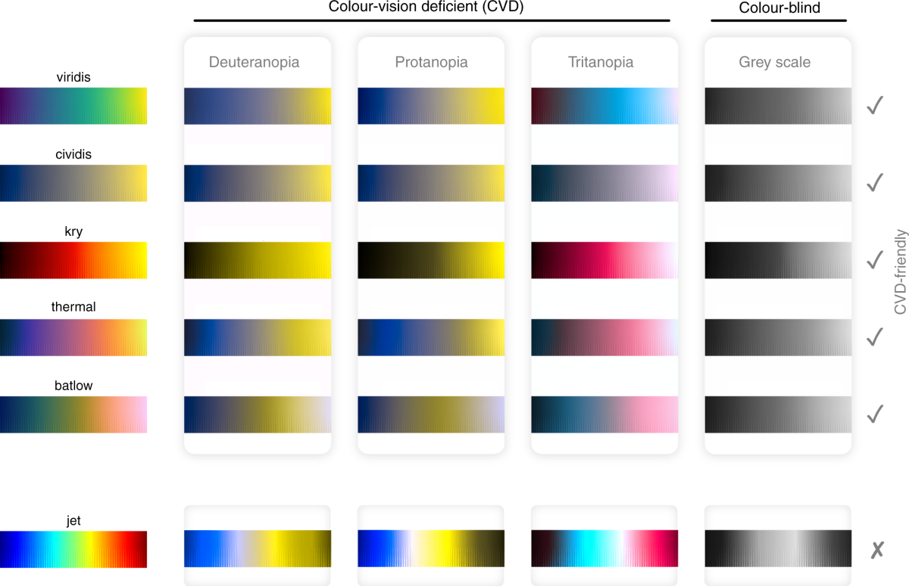
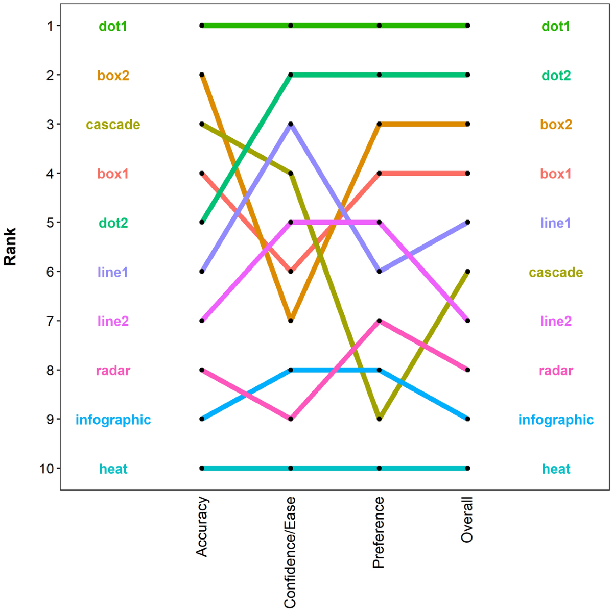

# 10. Summary communication and accessibility

[Collection index](../README.md) · [Research guide](../../wf2-projections-research-guide.md)

## Check colour accessibility before sharing

Colour-map comparisons under several forms of colour-vision deficiency and in greyscale.

**Regional adaptation:** Choose a perceptually uniform palette appropriate to the variable; add labels and
symbols so colour is not the only encoding.

**Source:** Crameri, Shephard and Heron (2020), The misuse of colour in science communication, Nature
Communications 11, 5444. Figure 2.

[Paper and original caption](https://www.nature.com/articles/s41467-020-19160-7) · [Publisher image](https://media.springernature.com/lw1200/springer-static/image/art%3A10.1038%2Fs41467-020-19160-7/MediaObjects/41467_2020_19160_Fig2_HTML.png)

**Rights:** CC BY 4.0

**File:** 1200 × 775 pixels; retrieved 2026-10-07; unchanged publisher image.

## Assess comprehension as well as visual preference

Display rankings across accuracy, confidence/ease and preference.

**Regional adaptation:** For the suite's regional summary, test retrieval of change magnitude, ensemble
disagreement and threshold implications with intended readers.

**Source:** Bannister et al. (2021), Improving the visual communication of environmental model projections,
Scientific Reports 11, 19157. Figure 4.

[Paper and original caption](https://www.nature.com/articles/s41598-021-98290-4) · [Publisher image](https://media.springernature.com/lw1200/springer-static/image/art%3A10.1038%2Fs41598-021-98290-4/MediaObjects/41598_2021_98290_Fig4_HTML.png)

**Rights:** CC BY 4.0

**File:** 1200 × 1199 pixels; retrieved 2026-10-07; unchanged publisher image.
